<p align="center">
  <picture>
    <source media="(prefers-color-scheme: dark)" srcset="https://raw.githubusercontent.com/webysther/ha-arpa-piemonte/main/custom_components/arpa_piemonte/brand/dark_icon@2x.png">
    
  </picture>
</p>

<h1 align="center">Arpa Piemonte</h1>

<p align="center">Flusspegel, Regen, Temperatur, Wind und Schnee der Stationen von Arpa Piemonte und die Naturgefahren ihrer Gemeinden, in Home Assistant</p>

<p align="center">
  <a href="https://github.com/webysther/ha-arpa-piemonte/releases/latest"></a>
  <a href="https://www.home-assistant.io/integrations/marketplace/"></a>
  <a href="https://github.com/webysther/ha-arpa-piemonte/actions/workflows/tests.yaml"></a>
  <a href="https://github.com/webysther/ha-arpa-piemonte/blob/main/LICENSE.md"></a>
</p>

<p align="center"><a href="https://github.com/webysther/ha-arpa-piemonte/blob/main/README.md">English</a> · <a href="https://github.com/webysther/ha-arpa-piemonte/blob/main/README.it.md">Italiano</a> · <a href="https://github.com/webysther/ha-arpa-piemonte/blob/main/README.fr.md">Français</a> · <a href="https://github.com/webysther/ha-arpa-piemonte/blob/main/README.es.md">Español</a> · <b>Deutsch</b></p>

Die Messwerte der Stationen von [Arpa Piemonte](https://www.arpa.piemonte.it)
in Home Assistant: **Flusspegel**, mit den Warnschwellen jedes Pegelmessers,
**Regen**, Temperatur, Luftfeuchtigkeit, Wind und Schnee, für jede der 374
Stationen des Messnetzes des Piemont; und die **Naturgefahren** ihrer
Gemeinden: die Warnungen des Bulletins für heute und morgen, die aktuelle
Gefahr, die Einsatzphase, die Erdbeben in der Nähe, die Hitzewellen und die
Lawinengefahr.

> Keine offizielle App von Arpa Piemonte und nicht von ihr gebilligt. Die
> Daten sind nur automatisch validiert. Verlasse dich für deine Sicherheit
> nicht auf sie: Folge bei Warnungen den offiziellen Bulletins und dem
> Zivilschutz.

<p align="center">
  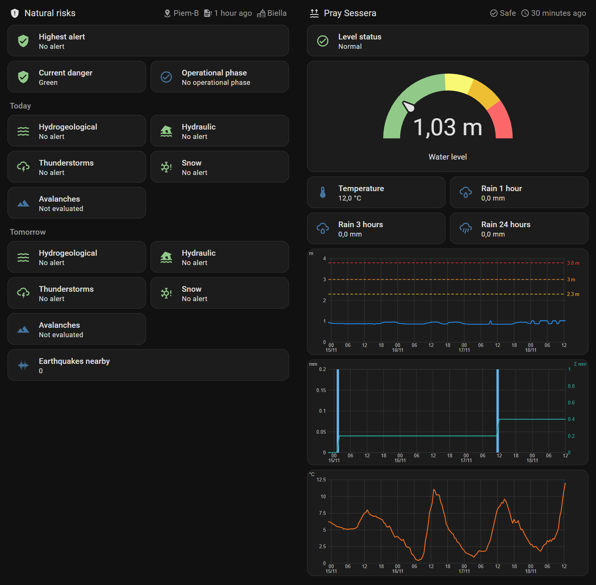
</p>

## Funktionen

- Ein Gerät pro Station, mit den Sensoren, die sie hat: Ein Pegelmesser
  bekommt seinen Pegelstand, seinen Status gegenüber den Schwellen (Normal,
  Voralarm, Wachdienst, Gefahr) und ein Überflutungsrisiko, an ab der
  Voralarmschwelle; eine Wetterstation ihren Regen, ihre Temperatur,
  Luftfeuchtigkeit, Wind und Schnee, und mit einem Barometer oder einem
  Radiometer den Luftdruck und die Sonnenstrahlung.
- Die Stationen nach Gemeinde gruppiert: ein Eintrag pro Gemeinde, mit ihren
  Stationen darunter.
- Die aktuellsten Messwerte: die der App Meteo 3R von Arpa Piemonte, alle 30
  Minuten.
- Wenn Meteo 3R nicht antwortet oder einer seiner Messwerte zu alt ist,
  übernehmen die offiziellen Quellen von Arpa Piemonte: die Dateien ihrer
  Website, dann ihre api_realtime. Der Sensor **Datenquelle** sagt, welche
  angezeigt wird.
- Die Zeit der Messung, nicht des Downloads: **Letzte Messung**.
- Diagramme der letzten 3 bis 4 Tage, als Bilder: der Pegelstand mit seinen
  Schwellen, der Regen jeder Stunde mit seiner Summe, Temperatur,
  Luftfeuchtigkeit, Schnee, Wind, Luftdruck und Sonnenstrahlung. Die
  Integration zeichnet sie aus den Messwerten, die sie schon hat.
- Die Naturgefahren jeder Gemeinde, auf einem eigenen Gerät, so wie das
  Widget der Gemeinde auf der Arpa-Website sie angibt: die Stufe jedes Risikos
  des Warnbulletins (hydrogeologisch, Hochwasser, Gewitter, Schnee, Lawinen)
  für heute und morgen, jede mit einem Sicherheits-Binärsensor, der ab der
  gewählten Mindestwarnstufe an ist; die höchste Warnung; die aktuelle Gefahr,
  aus dem gemessenen Regen und den Flüssen; und die Einsatzphase, die die
  Gemeinde ausgerufen hat.
- Die Erdbeben der letzten 30 Tage in der Nähe der Gemeinde oder deines
  Zuhauses, auf der Karte; die Hitzewellen der Hauptstadt ihrer Provinz oder
  der nächstgelegenen, im Sommer; und die Lawinengefahr ihrer Mikroregion, aus
  den Bulletins von AINEVA, im Winter.
- Ein [Dashboard](#dashboard): ein Tab pro Gemeinde, mit ihren Naturgefahren
  oben und einem Abschnitt pro Station, der Pegelstand in den Farben der
  Warnkarten und eine Analoganzeige mit seinen Schwellen; und eine
  [Karte](#karte) einer Station, in der Kartenauswahl.

## Anwendungsfälle

- Gewarnt werden, wenn der Fluss bei dir zu Hause die Voralarmschwelle
  erreicht, noch vor den offiziellen Bulletins.
- Am Nachmittag gewarnt werden, wenn das Bulletin deine Gemeinde für morgen
  auf orange Warnung setzt oder wenn die Gemeinde eine Einsatzphase ausruft.
- Vor einem Erdbeben im Umkreis von 50 km um dein Zuhause gewarnt werden.
- An einem Tag mit Wärmebelastung die Rollläden früh schließen, oder die
  Lawinengefahr prüfen, bevor du ins Tal hinauffährst.
- Den Regen der letzten 24 Stunden flussaufwärts verfolgen.
- Die Rollläden bei Windböen schließen, die Pflanzen bei Frost abdecken.

## Installation

Aus dem [Marketplace](https://www.home-assistant.io/integrations/marketplace/)
von Home Assistant:

[](https://my.home-assistant.io/redirect/marketplace_repository/?owner=webysther&repository=ha-arpa-piemonte&category=integration)

1. Öffne den Link oben oder **Einstellungen → Marketplace → Über Link
   hinzufügen** und füge `https://github.com/webysther/ha-arpa-piemonte`
   hinzu.
2. Öffne **Arpa Piemonte** und installiere die Integration.

Home Assistant 2025.4 oder neuer.

## Konfiguration

**Einstellungen → Geräte & Dienste → Integration hinzufügen → Arpa
Piemonte**, dann gib die Gemeinde der Station ein: Die Liste enthält die 278
Gemeinden des Piemont mit einer Station und findet „Mondovì“ so, wie Arpa
Piemonte es schreibt, „Mondovi'“. Wenn die Gemeinde mehrere Stationen hat,
wähle eine: zuerst die Flüsse, dann die Wetterstationen. Wähle die Stelle des
Flusses, die dich interessiert, nicht unbedingt die nächstgelegene.

<p align="center">
  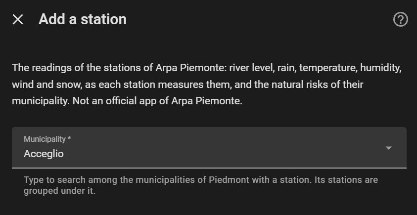
  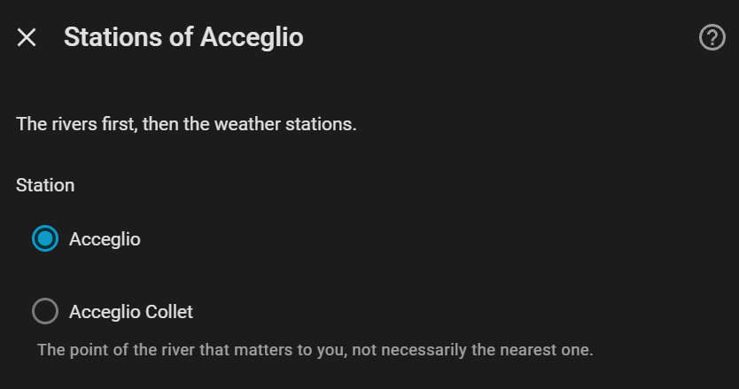
</p>

Jede Gemeinde ist ein Eintrag, mit ihren Stationen darunter und daneben einem
Gerät ihrer Naturgefahren. Um eine weitere Station einer Gemeinde
hinzuzufügen, wähle **Station hinzufügen** an ihrem Eintrag, oder füge die
Integration erneut hinzu und wähle dieselbe Gemeinde.

<p align="center">
  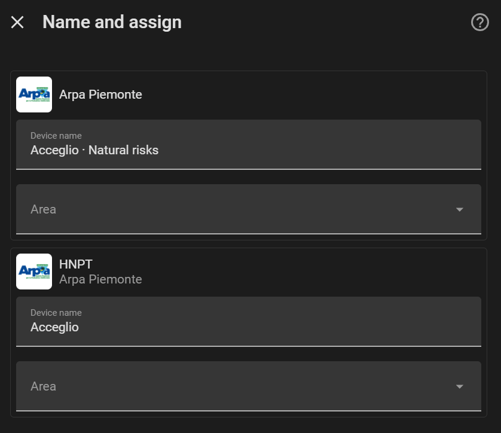
</p>

Um die Sensoren und Schwellen einer Station erneut von Arpa Piemonte
einzulesen, wähle **Station neu einlesen** an der Station. **Neu
konfigurieren** am Eintrag einer Gemeinde liest alle ihre Stationen neu ein.

### Optionen

**Konfigurieren** am Eintrag einer Gemeinde:

| Option | Was sie bewirkt |
| --- | --- |
| Mindestwarnstufe | Der Binärsensor jedes Risikos, heute und morgen, schaltet ab dieser Stufe des Bulletins ein: Gelbe Warnung (Standard), Orange Warnung oder Rote Warnung. |
| Position der Naturgefahren | Wo die Erdbeben, die Lawinengefahr und die nächstgelegene Hitzewellen-Stadt bestimmt werden: die Stationen der Gemeinde (Standard; ihre mittlere Position) oder das Zuhause von Home Assistant. |
| Radius der Erdbeben | Die Erdbeben innerhalb dieser Entfernung von der Position, in km: standardmäßig 50, wie beim DPC. |
| Hitzewellen-Stadt | Arpa gibt die Hitzewellen-Bulletins nur für die 8 Provinzhauptstädte heraus: die Hauptstadt der Provinz der Gemeinde (Standard) oder die nächstgelegene Hauptstadt zur Position. |

Die Integration liest die Position, wenn die Gemeinde eingerichtet wird:
Nachdem du das Zuhause von Home Assistant verschoben hast, lade die Gemeinde
neu.

## Entfernung

**Einstellungen → Geräte & Dienste → Arpa Piemonte**: **Löschen** im
Drei-Punkte-Menü einer Station entfernt sie; in dem einer Gemeinde entfernt es
die Gemeinde mit ihren Stationen und ihren Naturgefahren. Um die Integration
zu entfernen, lösche jede Gemeinde und deinstalliere sie dann aus dem
Marketplace.

## Wie die Daten aktualisiert werden

Alle 10 Minuten fragt die Integration Meteo 3R, ob sich die Datei der Station
geändert hat; meistens nicht, und es wird nichts heruntergeladen. Meteo 3R
veröffentlicht alle 30 Minuten einen Messwert, etwa 30 bis 45 Minuten nach
der Messung.

| Quelle | Messwerte | Verspätung | Abfrage |
| --- | --- | --- | --- |
| Meteo 3R | alle 30 min | ~40 min | alle 10 min |
| Dateien der Arpa-Website (Pegelstand, Temperatur, Luftfeuchtigkeit, Schnee) | stündlich | ~40 min | nur als Ausweichquelle, höchstens alle 20 min |
| Dateien der Arpa-Website (Luftdruck, Sonnenstrahlung) | stündlich | ~40 min | alle 20 min: die einzige Quelle |
| api_realtime von Arpa Piemonte (alles andere) | stündlich | ~3 h 40 min | nur als Ausweichquelle, höchstens alle 30 min |

Jeder Sensor zeigt den neuesten Messwert aller Quellen; bei gleicher Zeit den
von Meteo 3R. Ein Messwert, der älter als 6 Stunden ist, wird nicht
angezeigt: Der Sensor wird nicht verfügbar. **Datenquelle** sagt, woher die
Messwerte kommen, die Meteo 3R liefern kann; der Luftdruck und die
Sonnenstrahlung kommen immer von der Website.

Die Naturgefahren kommen aus dem Widget der Gemeinde auf der Arpa-Website,
das alle 10 Minuten abgefragt wird, meistens ohne Download: Arpa erstellt es
etwa alle 10 Minuten neu, aber seine Teile ändern sich seltener. Das
Warnbulletin wird einmal am Tag herausgegeben, gegen 13:00 Uhr, für diesen und
den nächsten Tag; die aktuelle Gefahr wird alle paar Stunden aus dem Regen und
den Flusspegeln der letzten 24 Stunden bewertet; die Einsatzphase ändert
sich, wenn die Gemeinde eine ausruft. Heute und morgen sind die Tage in
Italien: Um Mitternacht wird morgen zu heute, und das neue Morgen ist bis zum
nächsten Bulletin unbekannt.

| Gefahr | Herausgegeben | Abfrage |
| --- | --- | --- |
| Warnungen, aktuelle Gefahr, Einsatzphase (Widget der Gemeinde) | das Bulletin einmal am Tag, gegen 13:00 Uhr; die Gefahr alle paar Stunden | alle 10 min |
| Erdbeben (Arpa) | innerhalb von Minuten ab Magnitude 2.5, darunter nach Überprüfung | alle 10 min |
| Hitzewellen (Arpa, 8 Hauptstädte) | einmal am Tag, vom 15. Mai bis etwa 30. September | alle 30 min |
| Lawinen (AINEVA, EAWS) | am Vortag, gegen 17:00 Uhr, von Dezember bis Mai | stündlich; außerhalb der Saison alle 6 Stunden |

Die meisten Antworten sind ein `304 Not Modified`, ohne Download.

## Bekannte Einschränkungen

- Der Verlauf von Home Assistant zeichnet einen Messwert auf, wenn er
  heruntergeladen wird, 30 bis 45 Minuten nach der Messung. **Letzte Messung**
  gibt die Zeit der Messung an.
- Nur die Stationen des Piemont. Meteo 3R zeigt auch die von Ligurien und dem
  Aostatal, die zu anderen Behörden gehören, unter anderen Bedingungen.
- Wenn nur die api_realtime antwortet, sind die Messwerte etwa 4 Stunden alt.
- Der Luftdruck und die Sonnenstrahlung kommen nur aus den Dateien der
  Website, stündlich: Solange sie nicht antwortet, werden sie nach 6 Stunden
  nicht verfügbar, während ihre Diagramme ihre letzten Messwerte behalten.
- Vor Home Assistant 2026.3 zeigt die Integration kein Symbol: Sie liefert ihr
  Symbol in ihrem eigenen Ordner mit, den ältere Versionen nicht lesen.
- Die Daten sind nur automatisch validiert, und Arpa Piemonte kann sie später
  korrigieren. Ein Sensor einer Station kann tagelang nicht antworten.
- Die Schwellen sind die von Arpa Piemonte; nicht jeder Pegelmesser hat alle
  drei (26 von 110 fehlt mindestens eine).
- Die Diagramme zeigen nur die Messwerte von Meteo 3R: Solange es nicht
  antwortet, behalten sie seine letzten Messwerte. Ihr Text ist grau, dunkler
  oder heller, wenn der Browser angibt, dass die Seite hell oder dunkel ist,
  unabhängig vom Design von Home Assistant.
- Vor Home Assistant 2026.5 ist das Dashboard nicht unter **Dashboard
  hinzufügen** aufgeführt: Füge es mit seinem YAML hinzu (siehe
  [Dashboard](#dashboard)).
- Das Dashboard liest die Schwellen, wenn es sich öffnet: Die Analoganzeige
  einer Station, die noch nicht geantwortet hatte, erscheint nach dem
  Neuladen der Seite.
- Jeden Morgen sind die Naturgefahren von morgen bis zum Bulletin des Tages,
  gegen 13:00 Uhr, unbekannt, und das Dashboard blendet sie aus.
- Die Naturgefahren sind die, die das Widget der Gemeinde angibt, aus den
  Warngebieten, in denen sie liegt: die meisten in einem, einige in zwei
  (Asti, Piem-G und Piem-L). Die Lawinen werden außerhalb der Saison nicht
  bewertet.
- Das Warnbulletin deckt nur das Piemont ab: Palestro, eine Gemeinde der
  Lombardei mit einer Station von Arpa Piemonte, hat keine Warnungen, nur die
  Erdbeben, die Hitzewellen der nächstgelegenen Hauptstadt und die Lawinen.
- Die Hitzewellen sind vom 15. Mai bis etwa 30. September bekannt, die
  Lawinengefahr von Dezember bis Mai: Außerhalb der Saison sind sie
  unbekannt. Die Lawinengefahr gibt es nur, wo die Position in einer der 14
  Mikroregionen der Bulletins liegt, den Bergen: für die Stationen die ihres
  Mittelpunkts oder sonst die einer Station in einer davon.
- Die Erdbeben sind die der letzten 30 Tage, mit Magnitude 1.0 oder mehr, im
  Piemont und in seiner Umgebung; ein Erdbeben unter 2.5 erscheint, sobald ein
  Seismologe es überprüft hat, eine Stunde oder später.

## Fehlerbehebung

- **Ein Sensor ist nicht verfügbar**: Die Station hat ihn seit 6 Stunden
  nicht gemessen, oder keine Quelle antwortet. Prüfe die Station auf der
  [Website von Arpa Piemonte](https://www.arpa.piemonte.it/rischi_naturali/snippets_arpa_graphs/dettaglio_stazione/)
  (das Gerät verlinkt auf ihre Seite).
- **Datenquelle ist nicht Meteo 3R**: Meteo 3R hat nicht geantwortet; die
  Integration kehrt dazu zurück, sobald es antwortet.
- **Die Station kann nicht hinzugefügt werden**: Arpa Piemonte hat nicht
  geantwortet; versuche es später erneut.
- **Die Naturgefahren sind nicht verfügbar**: Ihre Quelle hat nicht
  geantwortet; die Integration fragt bei ihrer nächsten Aktualisierung erneut.
  Das Gerät der Naturgefahren verlinkt auf die Seite des Widgets auf der
  Arpa-Website.
- **Keine Entität für Erdbeben, Hitzewelle oder Lawinen**: Mit der Position
  der Stationen hat eine Gemeinde, deren Stationen alle entfernt wurden, keine
  Position.
- Andernfalls lade die Diagnosedaten herunter (das Drei-Punkte-Menü der
  Gemeinde auf der Seite der Integration oder die Seite des Geräts der
  Station) und eröffne ein
  [Issue](https://github.com/webysther/ha-arpa-piemonte/issues) mit ihnen und
  einem Debug-Protokoll.

## Entitäten

Von jeder Station die ihrer Sensoren:

| Entität | Einheit | Bei einer Station mit |
| --- | --- | --- |
| Pegelstand | m über dem Pegelnullpunkt | Pegelmesser |
| Pegelstatus: Normal, Voralarm, Wachdienst, Gefahr | | Pegelmesser |
| Überflutungsrisiko (Sicherheit): an ab der Voralarmschwelle | | Pegelmesser mit einer Schwelle |
| Voralarmschwelle, Wachdienstschwelle und Gefahrenschwelle (Diagnose) | m | Pegelmesser |
| Regen 1 Stunde, 3 Stunden, 24 Stunden | mm | Regenmesser |
| Temperatur | °C | Thermometer |
| Luftfeuchtigkeit | % | Hygrometer |
| Windgeschwindigkeit, Böengeschwindigkeit | km/h | Anemometer |
| Windrichtung, Böenrichtung | ° | Anemometer |
| Schneehöhe | cm | Schneepegel |
| Luftdruck, an der Station, nicht auf Meereshöhe | hPa | Barometer |
| Sonnenstrahlung | W/m² | Radiometer |
| Datenquelle (Diagnose): Meteo 3R, Arpa-Website, Arpa api_realtime | | jede Station |
| Letzte Messung (Diagnose) | | jede Station |
| Pegeldiagramm, Regendiagramm, Temperaturdiagramm, Luftfeuchtigkeitsdiagramm, Schneediagramm, Winddiagramm, Luftdruckdiagramm, Sonnenstrahlungsdiagramm (Bild) | | dem Sensor, den es zeigt |

Die Entitäts-IDs sind auf Englisch: `sensor.arpa_piemonte_pray_sessera_level`,
`binary_sensor.arpa_piemonte_pray_sessera_flood_risk`,
`image.arpa_piemonte_pray_sessera_level_chart`.

<p align="center">
  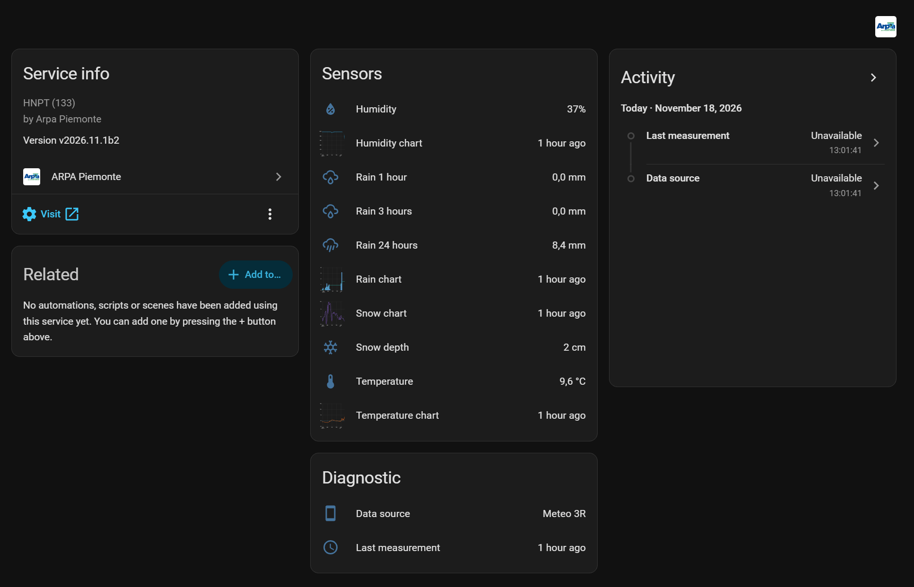
</p>

Von jeder Gemeinde ihre Naturgefahren, auf dem Gerät **Pray ·
Naturgefahren**:

| Entität | Zustände |
| --- | --- |
| Höchste Warnung, von heute und morgen | nicht bewertet, keine Warnung (grün), gelbe, orange oder rote Warnung |
| Aktuelle Gefahr, aus dem gemessenen Regen und den Flüssen | nicht bewertet, grün, gelb, orange, rot |
| Einsatzphase der Gemeinde | keine Einsatzphase, Achtung, Voralarm, Alarm |
| Warnstufe hydrogeologisches Risiko, Hochwasserrisiko, Gewitterrisiko, Schneerisiko und Lawinenrisiko, heute und morgen | wie die höchste Warnung |
| Hydrogeologisches Risiko, Hochwasserrisiko, Gewitterrisiko, Schneerisiko und Lawinenrisiko, heute und morgen (Sicherheit) | an ab der Mindestwarnstufe |
| Warngebiet (Diagnose) | das Gebiet des Bulletins: `Piem-B` |
| Warnbulletin, Nächstes Warnbulletin (Diagnose) | wann es herausgegeben wurde, wann das nächste fällig ist |
| Erdbeben in der Nähe | wie viele innerhalb des Radius, in den letzten 30 Tagen |
| Erdbeben M 1.9 (Geolokalisierung), eines für jedes | seine Entfernung, in km; seine Magnitude, Zeit, Tiefe und sein seismischer Bezirk als Attribute |
| Hitzewelle heute, morgen | keine Wärmebelastung, Wärmebelastung Stufe 1, 2 oder 3 (grün bis rot) |
| Hitzewellen-Stadt (Diagnose) | die Hauptstadt, deren Bulletin es ist: `Biella` |
| Lawinengefahr heute, morgen | kein Schnee, 1 – Gering, 2 – Mäßig, 3 – Erheblich, 4 – Groß, 5 – Sehr groß: die höchste des Bulletins |
| Lawinen-Mikroregion (Diagnose) | die Mikroregion der Position: `Valle Stura` |

Ihre Entitäts-IDs: `sensor.arpa_piemonte_pray_highest_alert`,
`sensor.arpa_piemonte_pray_hydraulic_risk_level_tomorrow`,
`binary_sensor.arpa_piemonte_pray_hydraulic_risk_tomorrow`,
`geo_location.arpa_piemonte_pray_earthquake_261117064149`. Ein Risiko eines
Tages, den das Bulletin noch nicht abdeckt, ist unbekannt: morgen, am
Vormittag. Die Erdbeben, die Hitzewellen und die Lawinen gibt es nur, wo die
Gemeinde sie hat: eine Position, eine Hauptstadt, eine Mikroregion.

<p align="center">
  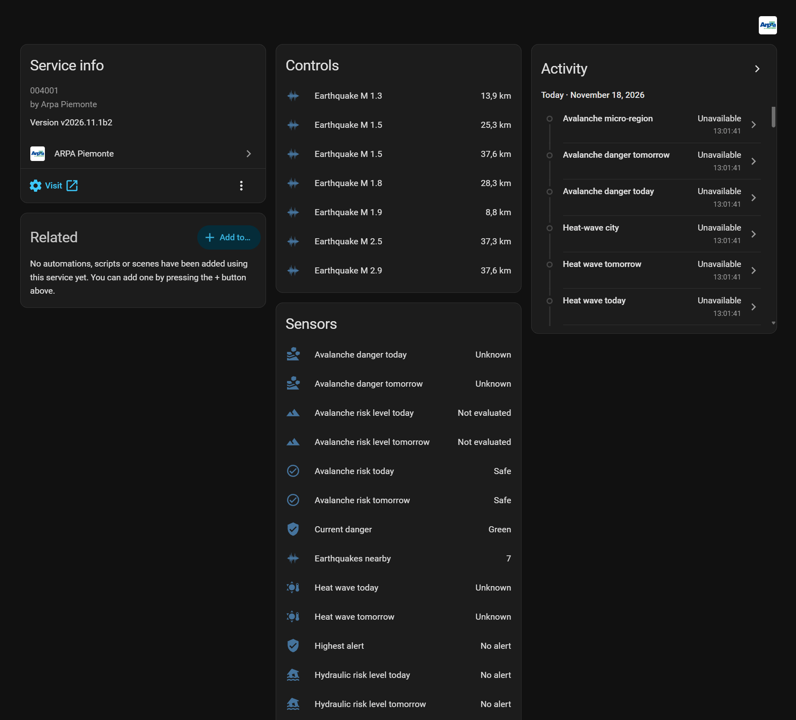
</p>

Der Zustand eines Diagramms ist die Zeit seines neuesten Messwerts. Die
Diagramme tragen keine Wörter, nur Einheiten und Werte: Die gestrichelten
Linien des Pegelstands sind die Voralarmschwelle (gelb), die
Wachdienstschwelle (orange) und die Gefahrenschwelle (rot), die Balken des
Regens sind der Regen jeder Stunde und die Linie seine Summe über das
Diagramm (rechte Achse, Σ mm); die Punkte des Winds sind die Böen. Die
Diagramme des Luftdrucks und der Sonnenstrahlung haben einen Messwert pro
Stunde, aus den Dateien der Website, über dieselben Tage wie die anderen.

<p align="center">
  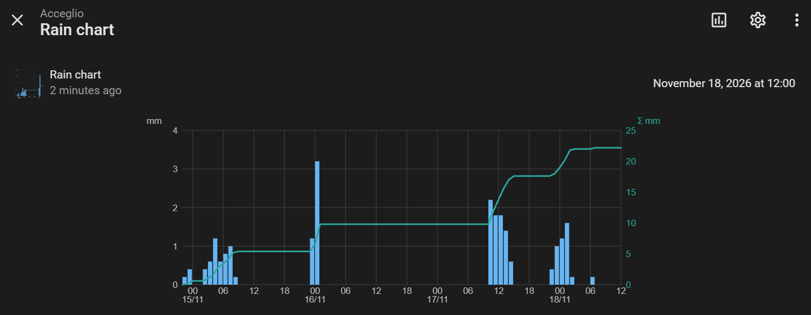
  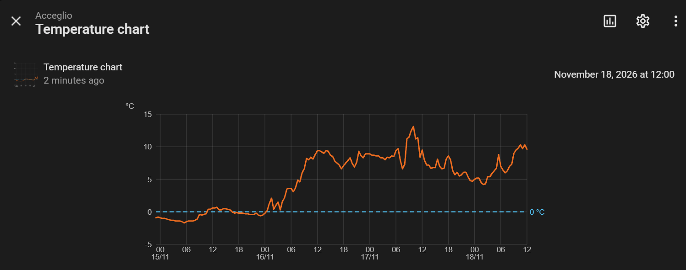
  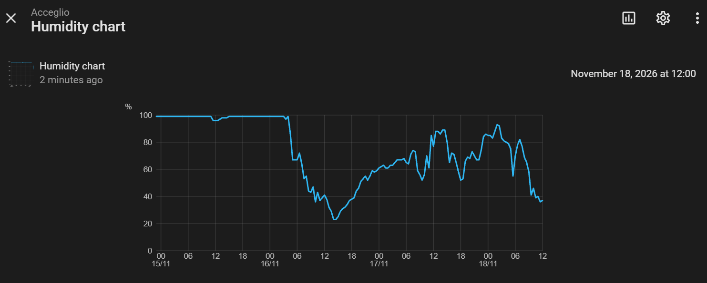
</p>

Die Barometer und Radiometer sind die, die die Stationsliste der Arpa-Website
nennt: 45 und 64 am 2026-11-17, während die Buchstaben der Sensoren in
Meteo 3R 47 und 66 nennen, deren Dateien leer, Jahre alt oder nicht
vorhanden sind. Wenn diese Liste beim Hinzufügen einer Station nicht
antwortete, treten die Buchstaben an ihre Stelle: **Station neu einlesen**
behebt das.

## Beispiele für Automationen

Benachrichtigung, wenn der Fluss eine Schwelle erreicht:

```yaml
automation:
  - alias: "Sessera über einer Schwelle"
    triggers:
      - trigger: state
        entity_id: binary_sensor.arpa_piemonte_pray_sessera_flood_risk
        to: "on"
    actions:
      - action: notify.notify
        data:
          title: "Sessera bei Pray"
          message: >-
            Pegelstand {{ states('sensor.arpa_piemonte_pray_sessera_level') }} m:
            {{ states('sensor.arpa_piemonte_pray_sessera_level_status') }}
```

Benachrichtigung über eine Warnung für morgen, sobald das Bulletin
herausgegeben ist:

```yaml
automation:
  - alias: "Warnung morgen in Pray"
    triggers:
      - trigger: state
        entity_id:
          - binary_sensor.arpa_piemonte_pray_hydrogeological_risk_tomorrow
          - binary_sensor.arpa_piemonte_pray_hydraulic_risk_tomorrow
          - binary_sensor.arpa_piemonte_pray_thunderstorm_risk_tomorrow
          - binary_sensor.arpa_piemonte_pray_snow_risk_tomorrow
          - binary_sensor.arpa_piemonte_pray_avalanche_risk_tomorrow
        to: "on"
    actions:
      - action: notify.notify
        data:
          title: "Pray: Warnung morgen"
          message: "{{ trigger.to_state.name }}"
```

Benachrichtigung über ein Erdbeben innerhalb des Radius, sobald es erscheint:

```yaml
automation:
  - alias: "Erdbeben bei Pray"
    triggers:
      - trigger: geo_location
        source: arpa_piemonte
        zone: zone.home
        event: enter
    actions:
      - action: notify.notify
        data:
          message: >-
            {{ trigger.to_state.name }},
            {{ trigger.to_state.state }} km entfernt
```

Der Auslöser feuert bei einem Erdbeben innerhalb der Zone, deren Radius 100 m
beträgt, sofern du ihn nicht änderst: Gib ihr den gewünschten Radius, oder
löse stattdessen aus, wenn `sensor.arpa_piemonte_pray_nearby_earthquakes`
steigt.

Benachrichtigung, wenn der Fluss schnell steigt:

```yaml
automation:
  - alias: "Sessera steigt"
    triggers:
      - trigger: numeric_state
        entity_id: sensor.arpa_piemonte_pray_sessera_level
        above: 1.5
    actions:
      - action: notify.notify
        data:
          message: "Die Sessera bei Pray liegt über 1.5 m"
```

## Dashboard

Die Integration bringt ein Dashboard mit, aufgebaut aus den Karten von Home
Assistant, mit den Namen der Entitäten in der Sprache jedes Benutzers. Es hat
einen Tab für jede Gemeinde, dessen erster Abschnitt ihre **Naturgefahren**
sind: das Warngebiet, die Zeit des Bulletins, die Hitzewellen-Stadt und die
Mikroregion; die höchste Warnung und die aktuelle Gefahr in den Farben der
Warnkarten, die Einsatzphase in den Farben des Widgets von Arpa; die Stufe
jedes Risikos, die Hitze und die Lawinengefahr, heute und morgen, jeweils
solange ihr Bulletin den Tag abdeckt; und die Erdbeben in der Nähe, auf einer
Karte mit ihrer Magnitude markiert.

Dann ein Abschnitt für jede Station, die Pegelmesser zuerst:

<p align="center">
  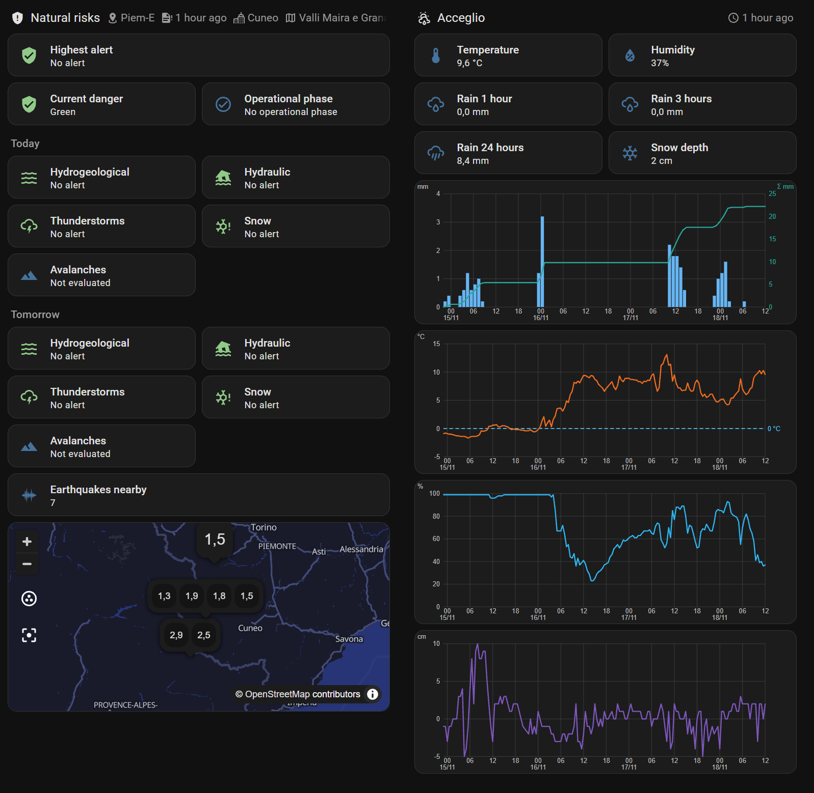
</p>

- **Die Überschrift**: der Name der Station, ihr Überflutungsrisiko in der
  Farbe ihres Pegelstands, die Zeit ihrer letzten Messung und, solange es
  nicht Meteo 3R ist, die Quelle ihrer Messwerte.
- **Der Pegelstand** eines Pegelmessers: sein Status in den Farben der
  Warnkarten, Grün, Gelb, Orange und Rot, und eine Analoganzeige mit einem
  Band über jeder Schwelle, von 0 bis zur höchsten Schwelle plus ein Viertel
  (Pray Sessera, mit 2.3, 3.0 und 3.8 m, geht bis 4.75 m). Ein Pegelmesser
  ohne Schwellen zeigt seinen Pegelstand.
- **Die Messwerte**: Temperatur, Luftfeuchtigkeit, die drei Regenwerte, Wind,
  Böe und Schnee, wie die Station sie misst.
- **Die Diagramme**, sobald Meteo 3R die Messwerte der Station geliefert hat.

Um es hinzuzufügen, ab Home Assistant 2026.5:

1. Gehe zu **Einstellungen → Dashboards → Dashboard hinzufügen**.
2. Wähle **Arpa Piemonte**. Falls es nicht aufgeführt ist, lade die Seite neu.

Vor Home Assistant 2026.5:

1. Gehe zu **Einstellungen → Dashboards → Dashboard hinzufügen → Neues
   Dashboard von Grund auf** und öffne es.
2. Wähle **⋮ → Dashboard bearbeiten**, dann **⋮ → Raw-Konfigurationseditor**.
3. Ersetze seinen Inhalt durch:

   ```yaml
   strategy:
     type: custom:arpa-piemonte
   ```

Das Dashboard folgt deinen Stationen und den Namen, die du ihren Geräten
gibst: Ab Home Assistant 2026.7 ändert es sich von selbst, wenn du eine
hinzufügst oder entfernst; davor, wenn du die Seite neu lädst. Um die
Stationen einer Gemeinde in einem anderen Dashboard anzuzeigen, füge eine
Ansicht mit der Strategie und der ID des Eintrags der Gemeinde hinzu
(`entry_id`, in ihren Diagnosedaten):

```yaml
views:
  - title: Pray
    strategy:
      type: custom:arpa-piemonte
      entry_id: 01JCQK3Z5T3K8W6B2V4M9H7XNE
```

## Karte

Die Karte einer Station, in der Kartenauswahl, sobald die Integration
installiert ist: Suche nach **Arpa Piemonte** (`custom:arpa-piemonte-card`).
Sie ist der Abschnitt der Station im Dashboard, als einzelne Karte aus den
Karten von Home Assistant: Sie findet die Entitäten der Station, auch nachdem
du sie umbenannt hast, färbt den Pegelstatus und das Überflutungsrisiko wie
den Pegelstand und zeigt die Diagramme, die Daten haben.

<p align="center">
  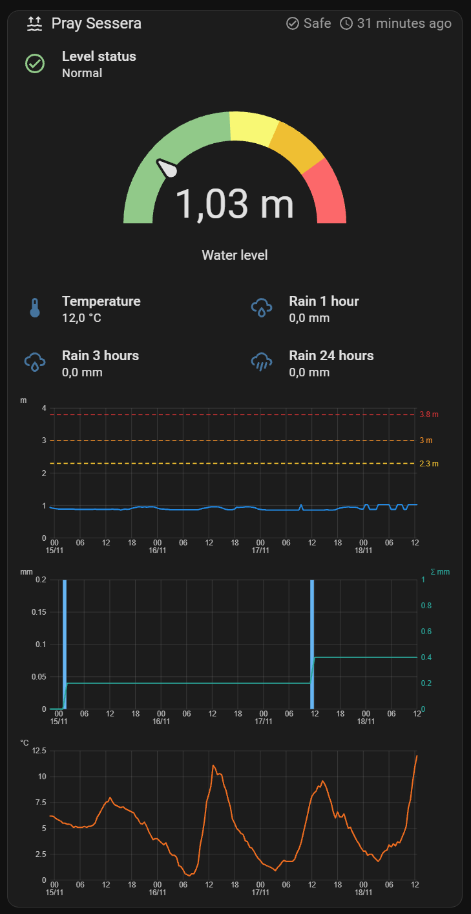
</p>

Der visuelle Editor wählt die Station und was die Karte zeigt. In YAML zeigt
eine weggelassene Option alles an:

| Option | Ohne sie |
| --- | --- |
| `device_id` | Die erste Station. Die ID des Geräts der Station, das Ende der Adresse seiner Geräteseite. |
| `show_title: false` | Der Name der Station, über dem Rest. Ohne ihn rücken die Badges an den Anfang. |
| `show_flood_risk: false` | Das Überflutungsrisiko, in der Farbe des Pegelstands, neben dem Namen. |
| `show_last_measurement: false` | Die Zeit der letzten Messung, neben dem Namen. |
| `show_level: false` | Der Status des Pegelstands und seine Analoganzeige. |
| `show_readings: false` | Die Messwerte. |
| `show_charts: false` | Die Diagramme. |
| `columns: 1` | Die Messwerte in zwei Spalten. |

```yaml
# Der Pegelstand von Pray Sessera und seine Diagramme, ohne die Messwerte
type: custom:arpa-piemonte-card
device_id: 0123456789abcdef0123456789abcdef
show_readings: false
```

Ein einzelnes Diagramm, mit den Karten von Home Assistant:

```yaml
type: picture-entity
entity: image.arpa_piemonte_pray_sessera_level_chart
show_name: false
show_state: false
```

## Datenquelle und Namensnennung

Die Daten stammen von **Arpa Piemonte**, unter der Lizenz
[Creative Commons Namensnennung 4.0](https://creativecommons.org/licenses/by/4.0/)
([rechtliche Hinweise](https://www.arpa.piemonte.it/note-legali)): „Fonte:
Arpa Piemonte - www.arpa.piemonte.it“. Jede Entität trägt diese Namensnennung,
und jedes Gerät verlinkt auf die Seite seiner Station oder, bei den
Naturgefahren, auf die Seite des Widgets der Gemeinde, wo Arpa sie zeigt.

Die Lawinenbulletins sind die von AINEVA für das Piemont, so wie die
Europäischen Lawinenwarndienste (EAWS) sie veröffentlichen, „Fonte: AINEVA
Piemonte - bollettini.aineva.it“, was ihre Entitäten tragen; ihre
Mikroregionen sind die von EAWS (CC0). Nicht mit AINEVA oder EAWS verbunden.

Die Integration liest Meteo 3R mit
[aiometeo3r](https://github.com/webysther/aio-meteo3r) und die offiziellen
Quellen mit [aioarpapiemonte](https://github.com/webysther/aio-arpa-piemonte).

## Mitwirken

Siehe [CONTRIBUTING.md](https://github.com/webysther/ha-arpa-piemonte/blob/main/CONTRIBUTING.md)
(auf Englisch).

## Lizenz

Der Code von Arpa Piemonte steht unter der
[MIT-Lizenz](https://github.com/webysther/ha-arpa-piemonte/blob/main/LICENSE.md).
Die Messwerte sind Daten von Arpa Piemonte, unter der Lizenz
[CC BY 4.0](https://creativecommons.org/licenses/by/4.0/): Jede Entität trägt
diese Namensnennung.

Die Namen, Logos und Marken in diesem Repository, etwa die von Arpa Piemonte,
Meteo 3R und Home Assistant, gehören ihren Inhabern und dienen nur dazu, sie
zu kennzeichnen, ohne eine Billigung durch sie zu implizieren. Sie fallen
weder unter die Lizenz des Codes noch unter die Lizenz CC BY 4.0 der Daten.
