<p align="center">
  <picture>
    <source media="(prefers-color-scheme: dark)" srcset="https://raw.githubusercontent.com/webysther/ha-arpa-piemonte/main/custom_components/arpa_piemonte/brand/dark_icon@2x.png">
    
  </picture>
</p>

<h1 align="center">Arpa Piemonte</h1>

<p align="center">Niveles de los ríos, lluvia, temperatura, viento y nieve de las estaciones de Arpa Piemonte, y los riesgos naturales de sus municipios, en Home Assistant</p>

<p align="center">
  <a href="https://github.com/webysther/ha-arpa-piemonte/releases/latest"></a>
  <a href="https://www.home-assistant.io/integrations/marketplace/"></a>
  <a href="https://github.com/webysther/ha-arpa-piemonte/actions/workflows/tests.yaml"></a>
  <a href="https://github.com/webysther/ha-arpa-piemonte/blob/main/LICENSE.md"></a>
</p>

<p align="center"><a href="https://github.com/webysther/ha-arpa-piemonte/blob/main/README.md">English</a> · <a href="https://github.com/webysther/ha-arpa-piemonte/blob/main/README.it.md">Italiano</a> · <a href="https://github.com/webysther/ha-arpa-piemonte/blob/main/README.fr.md">Français</a> · <b>Español</b> · <a href="https://github.com/webysther/ha-arpa-piemonte/blob/main/README.de.md">Deutsch</a></p>

Las mediciones de las estaciones de [Arpa Piemonte](https://www.arpa.piemonte.it)
en Home Assistant: **niveles de los ríos**, con los umbrales de alerta de cada
hidrómetro, **lluvia**, temperatura, humedad, viento y nieve, para cualquiera
de las 374 estaciones de la red del Piamonte; y los **riesgos naturales** de
sus municipios: las alertas del boletín de hoy y mañana, el peligro actual, la
fase operativa, los terremotos cercanos, las olas de calor y el peligro de
aludes.

> No es una app oficial de Arpa Piemonte, ni cuenta con su respaldo. Los datos
> solo se validan automáticamente. No dependas de ellos para tu seguridad: para
> las alertas, sigue los boletines oficiales y a la protección civil.

<p align="center">
  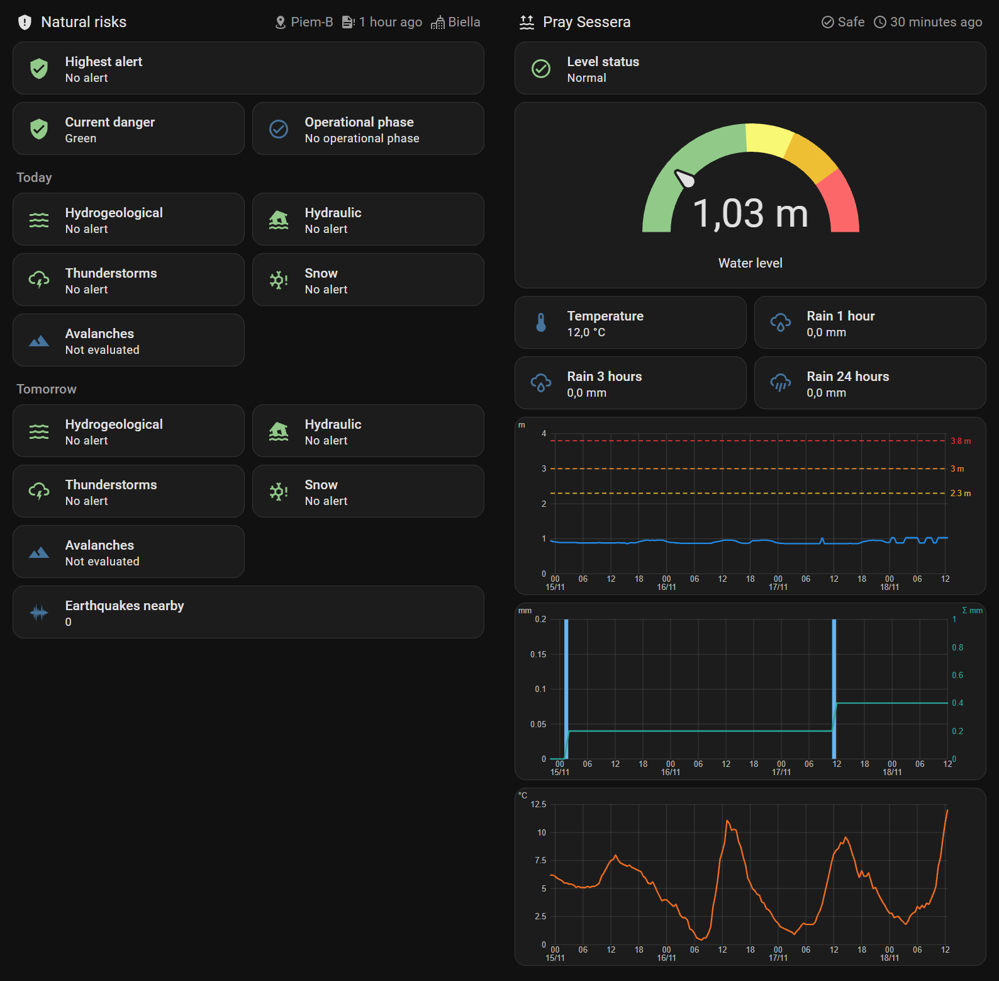
</p>

## Características

- Un dispositivo por estación, con los sensores que tiene: un hidrómetro recibe
  su nivel del agua, su estado frente a los umbrales (normal, prealarma,
  guardia, peligro) y un riesgo de crecida, activado desde el umbral de
  prealarma; una estación meteorológica, su lluvia, temperatura, humedad,
  viento y nieve y, con un barómetro o un radiómetro, la presión atmosférica y
  la radiación solar.
- Las estaciones agrupadas por municipio: una entrada por municipio, con sus
  estaciones debajo.
- Las mediciones más recientes: las de la app Meteo 3R de Arpa Piemonte, cada
  30 minutos.
- Cuando Meteo 3R no responde, o una medición suya es demasiado antigua, toman
  el relevo las fuentes oficiales de Arpa Piemonte: los archivos de su sitio
  web y luego su api_realtime. El sensor **Fuente de los datos** indica cuál se
  muestra.
- La hora de la medición, no la de la descarga: **Última medición**.
- Gráficos de los últimos 3 a 4 días, como imágenes: el nivel con sus
  umbrales, la lluvia de cada hora con su total, temperatura, humedad, nieve,
  viento, presión y radiación solar. La integración los dibuja a partir de las
  mediciones que ya tiene.
- Los riesgos naturales de cada municipio, en un dispositivo propio, tal como
  los da el widget del municipio en el sitio web de Arpa: el nivel de cada
  riesgo del boletín de alerta (hidrogeológico, hidráulico, tormentas, nieve,
  aludes) hoy y mañana, cada uno con un sensor binario de seguridad activado
  desde el nivel de alerta que elijas; la alerta máxima; el peligro actual, a
  partir de la lluvia y los ríos medidos; y la fase operativa que declaró el
  municipio.
- Los terremotos de los últimos 30 días cerca del municipio, o cerca de tu
  casa, en el mapa; las olas de calor de la capital de su provincia, o de la
  más cercana, en verano; y el peligro de aludes de su microrregión, a partir
  de los boletines de AINEVA, en invierno.
- Un [panel de control](#panel-de-control): una pestaña por municipio, con sus
  riesgos arriba y una sección por estación, el nivel en los colores de los
  mapas de alerta y un indicador con sus umbrales; y una [tarjeta](#tarjeta)
  de una estación, en el selector de tarjetas.

## Casos de uso

- Recibir un aviso cuando el río cerca de casa alcanza el umbral de
  prealarma, antes que los boletines oficiales.
- Recibir un aviso por la tarde cuando el boletín pone a tu municipio en
  alerta naranja mañana, o cuando el municipio declara una fase operativa.
- Recibir un aviso de un terremoto a menos de 50 km de casa.
- Cerrar las persianas temprano en un día de malestar por calor, o consultar
  el peligro de aludes antes de subir por el valle.
- Seguir la lluvia de las últimas 24 horas aguas arriba de un río.
- Cerrar las persianas cuando hay ráfagas de viento, tapar las plantas cuando
  hiela.

## Instalación

Desde el [Marketplace](https://www.home-assistant.io/integrations/marketplace/)
de Home Assistant:

[](https://my.home-assistant.io/redirect/marketplace_repository/?owner=webysther&repository=ha-arpa-piemonte&category=integration)

1. Abre el enlace de arriba, o **Configuración → Marketplace → Añadir desde
   enlace**, y añade `https://github.com/webysther/ha-arpa-piemonte`.
2. Abre **Arpa Piemonte** e instálala.

Home Assistant 2025.4 o posterior.

## Configuración

**Configuración → Dispositivos y servicios → Añadir integración → Arpa
Piemonte**, y luego escribe el municipio de la estación: la lista tiene los 278
municipios del Piamonte con una estación, y encuentra "Mondovì" tal como lo
escribe Arpa Piemonte, "Mondovi'". Cuando el municipio tiene varias
estaciones, elige una: primero los ríos, luego las estaciones meteorológicas.
Elige el punto del río que te interesa, no necesariamente el más cercano.

<p align="center">
  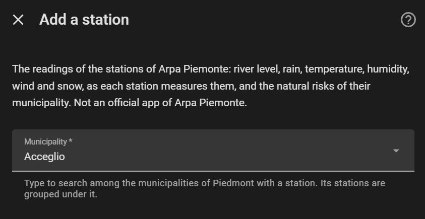
  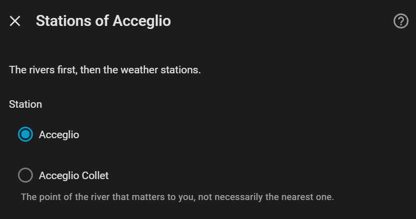
</p>

Cada municipio es una entrada, con sus estaciones debajo, y un dispositivo de
sus riesgos naturales junto a ellas. Para añadir otra estación de un
municipio, elige **Añadir estación** en su entrada, o añade la integración de
nuevo y elige el mismo municipio.

<p align="center">
  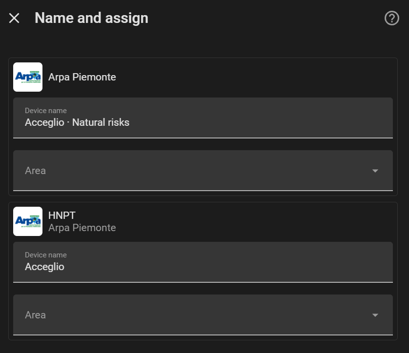
</p>

Para volver a leer de Arpa Piemonte los sensores y umbrales de una estación,
elige **Volver a leer la estación** en la estación. **Reconfigurar** en la
entrada de un municipio vuelve a leer todas sus estaciones.

### Opciones

**Configurar** en la entrada de un municipio:

| Opción | Qué hace |
| --- | --- |
| Nivel mínimo de alerta | El sensor binario de cada riesgo, hoy y mañana, se activa a partir de este nivel del boletín: alerta amarilla (por defecto), naranja o roja. |
| Posición de los riesgos | De dónde se toman los terremotos, el peligro de aludes y la ciudad de la ola de calor más cercana: las estaciones del municipio (por defecto; su posición media), o la casa de Home Assistant. |
| Radio de los terremotos | Los terremotos a menos de esta distancia de la posición, en km: 50 por defecto, como el DPC. |
| Ciudad de la ola de calor | Arpa emite los boletines de ola de calor solo para las 8 capitales de provincia: la capital de la provincia del municipio (por defecto), o la capital más cercana a la posición. |

La integración lee la posición cuando se configura el municipio: después de
mover la casa de Home Assistant, recarga el municipio.

## Eliminación

**Configuración → Dispositivos y servicios → Arpa Piemonte**: **Eliminar** en
los tres puntos de una estación la elimina; en los de un municipio, elimina el
municipio con sus estaciones y sus riesgos. Para eliminar la integración,
elimina todos los municipios y luego desinstálala desde el Marketplace.

## Cómo se actualizan los datos

Cada 10 minutos, la integración pregunta a Meteo 3R si el archivo de la
estación ha cambiado; la mayoría de las veces no ha cambiado, y no se descarga
nada. Meteo 3R publica una medición cada 30 minutos, unos 30 a 45 minutos
después de medirla.

| Fuente | Mediciones | Retraso | Consulta |
| --- | --- | --- | --- |
| Meteo 3R | cada 30 min | ~40 min | cada 10 min |
| Archivos del sitio web de Arpa (nivel, temperatura, humedad, nieve) | cada hora | ~40 min | solo como respaldo, cada 20 min como máximo |
| Archivos del sitio web de Arpa (presión, radiación solar) | cada hora | ~40 min | cada 20 min: la única fuente |
| api_realtime de Arpa Piemonte (todo lo demás) | cada hora | ~3 h 40 min | solo como respaldo, cada 30 min como máximo |

Cada sensor muestra la medición más reciente de todas las fuentes; a la misma
hora, la de Meteo 3R. Una medición de más de 6 horas no se muestra: el sensor
pasa a no disponible. **Fuente de los datos** indica de dónde vienen las
mediciones que Meteo 3R puede dar; la presión y la radiación solar siempre
vienen del sitio web.

Los riesgos naturales vienen del widget del municipio en el sitio web de Arpa,
consultado cada 10 minutos, la mayoría de las veces sin descarga: Arpa lo
reconstruye cada 10 minutos aproximadamente, pero sus partes cambian con menos
frecuencia. El boletín de alerta se emite una vez al día, hacia las 13:00, para
ese día y el siguiente; el peligro actual se evalúa cada pocas horas a partir
de la lluvia y los niveles de los ríos de las últimas 24 horas; la fase
operativa cambia cuando el municipio declara una. Hoy y mañana son los días en
Italia: a medianoche, mañana pasa a ser hoy, y el nuevo mañana es desconocido
hasta el siguiente boletín.

| Riesgo | Emisión | Consulta |
| --- | --- | --- |
| Alertas, peligro actual, fase operativa (widget del municipio) | el boletín una vez al día, hacia las 13:00; el peligro cada pocas horas | cada 10 min |
| Terremotos (Arpa) | en pocos minutos a partir de magnitud 2.5, por debajo tras su revisión | cada 10 min |
| Olas de calor (Arpa, 8 capitales) | una vez al día, del 15 de mayo a alrededor del 30 de septiembre | cada 30 min |
| Aludes (AINEVA, EAWS) | el día anterior, hacia las 17:00, de diciembre a mayo | cada hora; fuera de temporada, cada 6 horas |

La mayoría de las respuestas son un `304 Not Modified`, sin descarga.

## Limitaciones conocidas

- El historial de Home Assistant registra una medición cuando se descarga, de
  30 a 45 minutos después de medirla. **Última medición** da la hora de la
  medición.
- Solo las estaciones del Piamonte. Meteo 3R también muestra las de Liguria y
  el Valle de Aosta, que pertenecen a otros organismos, con otras condiciones.
- Cuando solo responde la api_realtime, las mediciones tienen unas 4 horas.
- La presión y la radiación solar solo vienen de los archivos del sitio web,
  cada hora: mientras no responde, pasan a no disponibles al cabo de 6 horas,
  y sus gráficos conservan sus últimas mediciones.
- Antes de Home Assistant 2026.3, la integración no muestra ningún icono: lleva
  su icono en su propia carpeta, que las versiones anteriores no leen.
- Los datos solo se validan automáticamente, y Arpa Piemonte puede corregirlos
  más tarde. Un sensor de una estación puede dejar de responder durante días.
- Los umbrales son los de Arpa Piemonte; no todos los hidrómetros tienen los
  tres (a 26 de 110 les falta al menos uno).
- Los gráficos solo muestran las mediciones de Meteo 3R: mientras no responde,
  conservan sus últimas mediciones. Su texto es gris, más oscuro o más claro
  cuando el navegador dice que la página es clara u oscura, sea cual sea el
  tema de Home Assistant.
- Antes de Home Assistant 2026.5, el panel de control no aparece en **Añadir
  panel de control**: añádelo con su YAML (consulta
  [Panel de control](#panel-de-control)).
- El panel de control lee los umbrales al abrirse: el indicador de una estación
  que aún no había respondido aparece después de recargar la página.
- Cada mañana, los riesgos de mañana son desconocidos hasta el boletín del
  día, hacia las 13:00, y el panel de control los oculta.
- Los riesgos son los que el widget da al municipio, según las zonas de alerta
  en las que se encuentra: la mayoría están en una, unos pocos en dos (Asti,
  Piem-G y Piem-L). Los aludes no se evalúan fuera de temporada.
- El boletín de alerta solo cubre el Piamonte: Palestro, un municipio de
  Lombardía con una estación de Arpa Piemonte, no tiene alertas, solo los
  terremotos, las olas de calor de la capital más cercana y los aludes.
- Las olas de calor se conocen del 15 de mayo a alrededor del 30 de
  septiembre, el peligro de aludes de diciembre a mayo: fuera de temporada, son
  desconocidos. El peligro de aludes solo existe donde la posición está en una
  de las 14 microrregiones de los boletines, la montaña: para las estaciones,
  la de su media o, si no, la de una estación que esté en una.
- Los terremotos son los de los últimos 30 días, de magnitud 1.0 o más, en el
  Piamonte y sus alrededores; un terremoto por debajo de 2.5 aparece cuando un
  sismólogo lo ha revisado, una hora o más después.

## Solución de problemas

- **Un sensor no está disponible**: la estación no lo ha medido en 6 horas, o
  ninguna fuente responde. Comprueba la estación en el
  [sitio web de Arpa Piemonte](https://www.arpa.piemonte.it/rischi_naturali/snippets_arpa_graphs/dettaglio_stazione/)
  (el dispositivo enlaza a su página).
- **Fuente de los datos no es Meteo 3R**: Meteo 3R no respondió; la
  integración vuelve a él en cuanto responde.
- **No se puede añadir la estación**: Arpa Piemonte no respondió; inténtalo de
  nuevo más tarde.
- **Los riesgos no están disponibles**: su fuente no respondió; la integración
  vuelve a preguntar en su siguiente actualización. El dispositivo de los
  riesgos enlaza a la página del widget en el sitio web de Arpa.
- **Ninguna entidad de terremotos, olas de calor o aludes**: con la posición
  de las estaciones, un municipio cuyas estaciones se eliminaron todas no tiene
  posición.
- Si no, descarga los diagnósticos (los tres puntos del municipio en la página
  de la integración, o la página del dispositivo de la estación) y abre un
  [issue](https://github.com/webysther/ha-arpa-piemonte/issues) con ellos y un
  registro de depuración.

## Entidades

De cada estación, las de sus sensores:

| Entidad | Unidad | De una estación con |
| --- | --- | --- |
| Nivel hidrométrico | m sobre el cero hidrométrico | hidrómetro |
| Estado del nivel: normal, prealarma, guardia, peligro | | hidrómetro |
| Riesgo de crecida (seguridad): activado desde el umbral de prealarma | | hidrómetro con un umbral |
| Umbral de prealarma, de guardia y de peligro (diagnóstico) | m | hidrómetro |
| Lluvia 1 hora, 3 horas, 24 horas | mm | pluviómetro |
| Temperatura | °C | termómetro |
| Humedad | % | higrómetro |
| Velocidad del viento, velocidad de las ráfagas | km/h | anemómetro |
| Dirección del viento, dirección de las ráfagas | ° | anemómetro |
| Altura de la nieve | cm | nivómetro |
| Presión atmosférica, en la estación, no a nivel del mar | hPa | barómetro |
| Radiación solar | W/m² | radiómetro |
| Fuente de los datos (diagnóstico): Meteo 3R, Sitio web de Arpa, api_realtime de Arpa | | todas las estaciones |
| Última medición (diagnóstico) | | todas las estaciones |
| Gráfico del nivel, de la lluvia, de la temperatura, de la humedad, de la nieve, del viento, de la presión, de la radiación solar (imagen) | | el sensor que muestra |

Los IDs de entidad están en inglés: `sensor.arpa_piemonte_pray_sessera_level`,
`binary_sensor.arpa_piemonte_pray_sessera_flood_risk`,
`image.arpa_piemonte_pray_sessera_level_chart`.

<p align="center">
  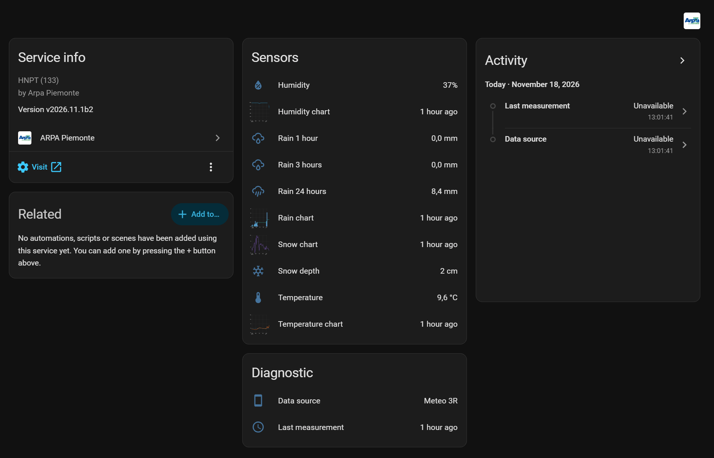
</p>

De cada municipio, sus riesgos naturales, en el dispositivo **Pray · Riesgos
naturales**:

| Entidad | Estados |
| --- | --- |
| Alerta máxima, de hoy y mañana | no evaluado, sin alerta (verde), alerta amarilla, naranja o roja |
| Peligro actual, a partir de la lluvia y los ríos medidos | no evaluado, verde, amarillo, naranja, rojo |
| Fase operativa municipal | ninguna fase operativa, atención, prealarma, alarma |
| Nivel de riesgo hidrogeológico, hidráulico, de tormentas, de nieve y de aludes, hoy y mañana | como la alerta máxima |
| Riesgo hidrogeológico, hidráulico, de tormentas, de nieve y de aludes, hoy y mañana (seguridad) | activado desde el nivel mínimo de alerta |
| Zona de alerta (diagnóstico) | la zona del boletín: `Piem-B` |
| Boletín de alerta, próximo boletín de alerta (diagnóstico) | cuándo se emitió, cuándo se espera el siguiente |
| Terremotos cercanos | cuántos dentro del radio, en los últimos 30 días |
| Terremoto M 1.9 (geolocalización), uno por cada terremoto | su distancia, en km; su magnitud, hora, profundidad y distrito sísmico como atributos |
| Ola de calor hoy, mañana | sin malestar, malestar de nivel 1, 2 o 3 (de verde a rojo) |
| Ciudad de la ola de calor (diagnóstico) | la capital de la que es el boletín: `Biella` |
| Peligro de aludes hoy, mañana | sin nieve, 1 débil, 2 limitado, 3 notable, 4 fuerte, 5 muy fuerte: el más alto del boletín |
| Microrregión de aludes (diagnóstico) | la microrregión de la posición: `Valle Stura` |

Sus IDs de entidad: `sensor.arpa_piemonte_pray_highest_alert`,
`sensor.arpa_piemonte_pray_hydraulic_risk_level_tomorrow`,
`binary_sensor.arpa_piemonte_pray_hydraulic_risk_tomorrow`,
`geo_location.arpa_piemonte_pray_earthquake_261117064149`. Un riesgo de un día
que el boletín aún no cubre es desconocido: el de mañana, por la mañana. Los
terremotos, las olas de calor y los aludes solo existen donde el municipio los
tiene: una posición, una capital, una microrregión.

<p align="center">
  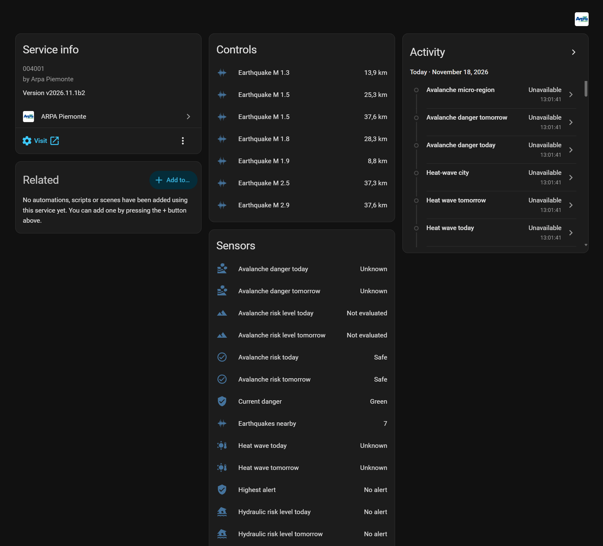
</p>

El estado de un gráfico es la hora de su medición más reciente. Los gráficos
no llevan palabras, solo unidades y valores: las líneas discontinuas del nivel
son los umbrales de prealarma (amarillo), guardia (naranja) y peligro (rojo),
las barras de la lluvia son la lluvia de cada hora, y la línea su total en el
gráfico (eje derecho, Σ mm); los puntos del viento son las ráfagas. Los
gráficos de la presión y la radiación solar tienen una medición cada hora, de
los archivos del sitio web, en los mismos días que los demás.

<p align="center">
  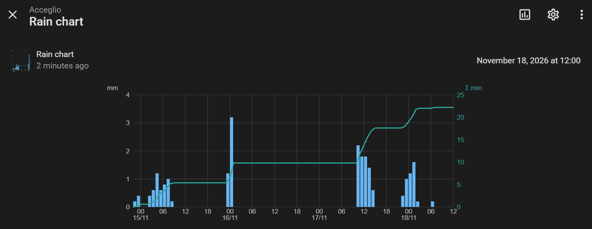
  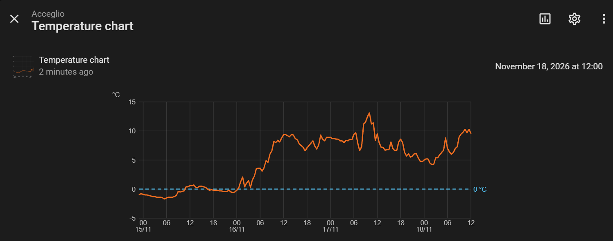
  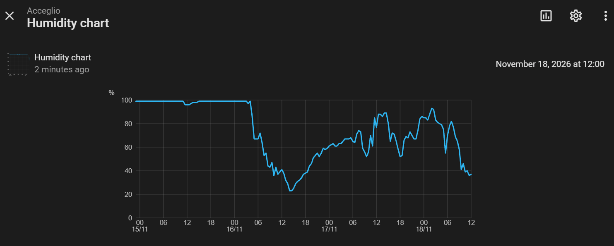
</p>

Los barómetros y radiómetros son los que nombra la lista de estaciones del
sitio web de Arpa: 45 y 64 el 2026-11-17, mientras que las letras de los
sensores en Meteo 3R nombran 47 y 66, cuyos archivos están vacíos, tienen años
o faltan. Cuando esa lista no respondió al añadir una estación, las letras la
sustituyen: **Volver a leer la estación** lo corrige.

## Ejemplos de automatizaciones

Recibe un aviso cuando el río alcanza un umbral:

```yaml
automation:
  - alias: "Sessera por encima de un umbral"
    triggers:
      - trigger: state
        entity_id: binary_sensor.arpa_piemonte_pray_sessera_flood_risk
        to: "on"
    actions:
      - action: notify.notify
        data:
          title: "Sessera en Pray"
          message: >-
            Nivel {{ states('sensor.arpa_piemonte_pray_sessera_level') }} m:
            {{ states('sensor.arpa_piemonte_pray_sessera_level_status') }}
```

Recibe un aviso de una alerta mañana, en cuanto se emite el boletín:

```yaml
automation:
  - alias: "Alerta mañana en Pray"
    triggers:
      - trigger: state
        entity_id:
          - binary_sensor.arpa_piemonte_pray_hydrogeological_risk_tomorrow
          - binary_sensor.arpa_piemonte_pray_hydraulic_risk_tomorrow
          - binary_sensor.arpa_piemonte_pray_thunderstorm_risk_tomorrow
          - binary_sensor.arpa_piemonte_pray_snow_risk_tomorrow
          - binary_sensor.arpa_piemonte_pray_avalanche_risk_tomorrow
        to: "on"
    actions:
      - action: notify.notify
        data:
          title: "Pray: alerta mañana"
          message: "{{ trigger.to_state.name }}"
```

Recibe un aviso de un terremoto dentro del radio, en cuanto aparece:

```yaml
automation:
  - alias: "Terremoto cerca de Pray"
    triggers:
      - trigger: geo_location
        source: arpa_piemonte
        zone: zone.home
        event: enter
    actions:
      - action: notify.notify
        data:
          message: >-
            {{ trigger.to_state.name }},
            a {{ trigger.to_state.state }} km
```

El disparador se activa con un terremoto dentro de la zona, cuyo radio es de
100 m salvo que lo cambies: dale el radio que quieras, o usa como disparador el
aumento de `sensor.arpa_piemonte_pray_nearby_earthquakes`.

Recibe un aviso cuando el río sube rápido:

```yaml
automation:
  - alias: "El Sessera sube"
    triggers:
      - trigger: numeric_state
        entity_id: sensor.arpa_piemonte_pray_sessera_level
        above: 1.5
    actions:
      - action: notify.notify
        data:
          message: "El Sessera en Pray supera 1.5 m"
```

## Panel de control

La integración incluye un panel de control hecho con las tarjetas de Home
Assistant, con los nombres de las entidades en el idioma de cada usuario.
Tiene una pestaña por cada municipio, cuya primera sección son sus **riesgos
naturales**: la zona de alerta, la hora del boletín, la ciudad de la ola de
calor y la microrregión; la alerta máxima y el peligro actual en los colores de
los mapas de alerta, la fase operativa en los colores del widget de Arpa; el
nivel de cada riesgo, el calor y el peligro de aludes, hoy y mañana, cada uno
mientras su boletín cubre el día; y los terremotos cercanos, en un mapa marcado
con su magnitud.

Luego una sección por cada estación, primero los hidrómetros:

<p align="center">
  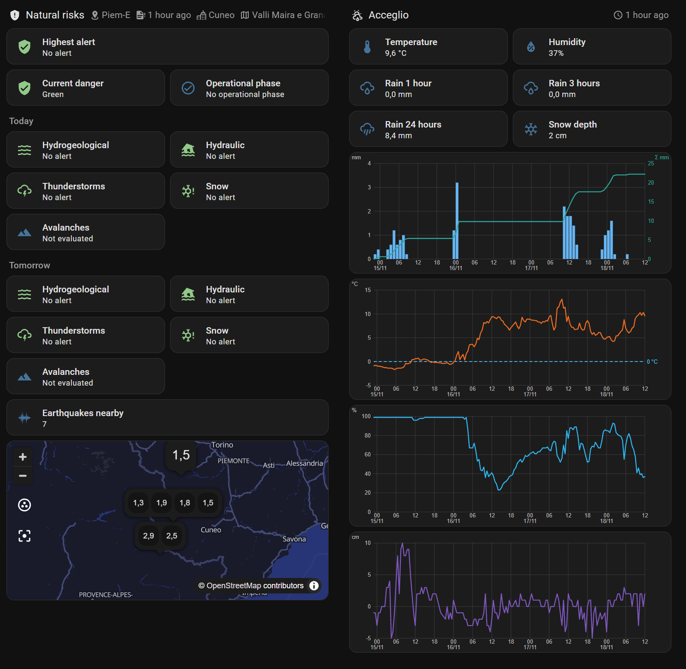
</p>

- **El encabezado**: el nombre de la estación, su riesgo de crecida en el color
  de su nivel, la hora de su última medición y, mientras no sea Meteo 3R, la
  fuente de sus mediciones.
- **El nivel** de un hidrómetro: su estado en los colores de los mapas de
  alerta, verde, amarillo, naranja y rojo, y un indicador con una banda por
  encima de cada umbral, de 0 al umbral más alto más una cuarta parte (Pray
  Sessera, con 2.3, 3.0 y 3.8 m, llega a 4.75 m). Un hidrómetro sin umbrales
  muestra su nivel.
- **Las mediciones**: temperatura, humedad, las tres lluvias, viento, ráfaga y
  nieve, según las mida la estación.
- **Los gráficos**, una vez que Meteo 3R ha dado las mediciones de la estación.

Para añadirlo, desde Home Assistant 2026.5:

1. Ve a **Configuración → Paneles de control → Añadir panel de control**.
2. Elige **Arpa Piemonte**. Si no aparece, recarga la página.

Antes de Home Assistant 2026.5:

1. Ve a **Configuración → Paneles de control → Añadir panel de control → Nuevo
   panel de control desde cero**, y ábrelo.
2. Elige **⋮ → Editar panel de control** y luego **⋮ → Editor de configuración
   en bruto**.
3. Sustituye su contenido por:

   ```yaml
   strategy:
     type: custom:arpa-piemonte
   ```

El panel de control sigue a tus estaciones y los nombres que das a sus
dispositivos: desde Home Assistant 2026.7 cambia por sí solo cuando añades o
eliminas una; antes, cuando recargas la página. Para mostrar las estaciones de
un municipio en otro panel de control, añade una vista con la estrategia y el
ID de la entrada del municipio (`entry_id`, en sus diagnósticos):

```yaml
views:
  - title: Pray
    strategy:
      type: custom:arpa-piemonte
      entry_id: 01JCQK3Z5T3K8W6B2V4M9H7XNE
```

## Tarjeta

La tarjeta de una estación, en el selector de tarjetas en cuanto se instala la
integración: busca **Arpa Piemonte** (`custom:arpa-piemonte-card`). Es la
sección de la estación en el panel de control, como una sola tarjeta hecha con
las tarjetas de Home Assistant: encuentra las entidades de la estación incluso
después de que les cambies el nombre, colorea el estado del nivel y el riesgo
de crecida según el nivel, y muestra los gráficos que tienen datos.

<p align="center">
  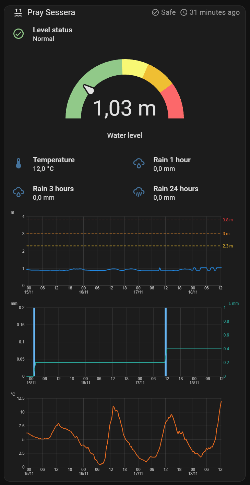
</p>

El editor visual elige la estación y lo que muestra la tarjeta. En YAML, una
opción omitida lo muestra todo:

| Opción | Sin ella |
| --- | --- |
| `device_id` | La primera estación. El ID del dispositivo de la estación, la parte final de la dirección de la página de su dispositivo. |
| `show_title: false` | El nombre de la estación, encima del resto. Sin él, las insignias pasan al principio. |
| `show_flood_risk: false` | El riesgo de crecida, en el color del nivel, junto al nombre. |
| `show_last_measurement: false` | La hora de la última medición, junto al nombre. |
| `show_level: false` | El estado del nivel y su indicador. |
| `show_readings: false` | Las mediciones. |
| `show_charts: false` | Los gráficos. |
| `columns: 1` | Las mediciones en dos columnas. |

```yaml
# El nivel de Pray Sessera y sus gráficos, sin las mediciones
type: custom:arpa-piemonte-card
device_id: 0123456789abcdef0123456789abcdef
show_readings: false
```

Un gráfico solo, con las tarjetas de Home Assistant:

```yaml
type: picture-entity
entity: image.arpa_piemonte_pray_sessera_level_chart
show_name: false
show_state: false
```

## Fuente de los datos y atribución

Los datos son de **Arpa Piemonte**, bajo la licencia
[Creative Commons Atribución 4.0](https://creativecommons.org/licenses/by/4.0/)
([notas legales](https://www.arpa.piemonte.it/note-legali)): "Fonte: Arpa
Piemonte - www.arpa.piemonte.it". Cada entidad lleva esta atribución, y cada
dispositivo enlaza a la página de su estación o, para los riesgos naturales, a
la página del widget del municipio, donde Arpa los muestra.

Los boletines de aludes son los de AINEVA para el Piamonte, tal como los
publican los Servicios Europeos de Aviso de Aludes (EAWS), "Fonte: AINEVA
Piemonte - bollettini.aineva.it", que llevan sus entidades; sus microrregiones
son las de EAWS (CC0). Sin afiliación con AINEVA ni con EAWS.

La integración lee Meteo 3R con
[aiometeo3r](https://github.com/webysther/aio-meteo3r) y las fuentes oficiales
con [aioarpapiemonte](https://github.com/webysther/aio-arpa-piemonte).

## Contribuir

Consulta [CONTRIBUTING.md](https://github.com/webysther/ha-arpa-piemonte/blob/main/CONTRIBUTING.md)
(en inglés).

## Licencia

El código de Arpa Piemonte está bajo la
[licencia MIT](https://github.com/webysther/ha-arpa-piemonte/blob/main/LICENSE.md).
Las mediciones son datos de Arpa Piemonte, bajo la licencia
[CC BY 4.0](https://creativecommons.org/licenses/by/4.0/): cada entidad lleva
esta atribución.

Los nombres, logotipos y marcas de este repositorio, como los de Arpa
Piemonte, Meteo 3R y Home Assistant, pertenecen a sus titulares y solo se usan
para identificarlos, sin implicar su respaldo. No están cubiertos por la
licencia del código ni por la licencia CC BY 4.0 de los datos.
