<p align="center">
  <picture>
    <source media="(prefers-color-scheme: dark)" srcset="https://raw.githubusercontent.com/webysther/ha-arpa-piemonte/main/custom_components/arpa_piemonte/brand/dark_icon@2x.png">
    
  </picture>
</p>

<h1 align="center">Arpa Piemonte</h1>

<p align="center">Niveau des cours d'eau, pluie, température, vent et neige des stations d'Arpa Piemonte, et les risques naturels de leurs communes, dans Home Assistant</p>

<p align="center">
  <a href="https://github.com/webysther/ha-arpa-piemonte/releases/latest"></a>
  <a href="https://www.home-assistant.io/integrations/marketplace/"></a>
  <a href="https://github.com/webysther/ha-arpa-piemonte/actions/workflows/tests.yaml"></a>
  <a href="https://github.com/webysther/ha-arpa-piemonte/blob/main/LICENSE.md"></a>
</p>

<p align="center"><a href="https://github.com/webysther/ha-arpa-piemonte/blob/main/README.md">English</a> · <a href="https://github.com/webysther/ha-arpa-piemonte/blob/main/README.it.md">Italiano</a> · <b>Français</b> · <a href="https://github.com/webysther/ha-arpa-piemonte/blob/main/README.es.md">Español</a> · <a href="https://github.com/webysther/ha-arpa-piemonte/blob/main/README.de.md">Deutsch</a></p>

Les mesures des stations d'[Arpa Piemonte](https://www.arpa.piemonte.it)
dans Home Assistant : **niveau des cours d'eau**, avec les seuils d'alerte de
chaque limnimètre, **pluie**, température, humidité, vent et neige, pour
n'importe laquelle des 374 stations du réseau du Piémont ; et les **risques
naturels** de leurs communes : les alertes du bulletin aujourd'hui et demain,
le danger actuel, la phase opérationnelle, les séismes à proximité, les
canicules et le danger d'avalanche.

> Ce n'est pas une application officielle d'Arpa Piemonte, ni approuvée par
> elle. Les données sont validées automatiquement seulement. Ne vous y fiez
> pas pour votre sécurité : pour les alertes, suivez les bulletins officiels
> et la protection civile.

<p align="center">
  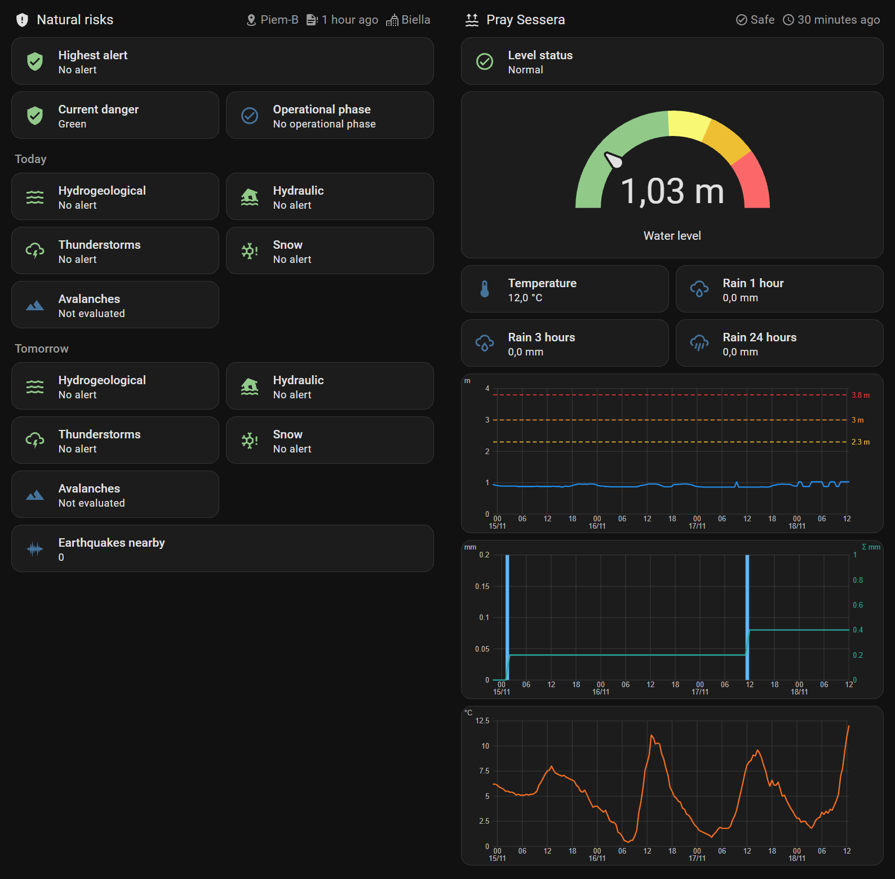
</p>

## Fonctionnalités

- Un appareil par station, avec les capteurs qu'elle a : un limnimètre a son
  niveau d'eau, son état par rapport aux seuils (normal, pré-alarme, garde,
  danger) et un risque de crue, activé à partir du seuil de pré-alarme ; une
  station météo sa pluie, sa température, son humidité, son vent et sa neige,
  et avec un baromètre ou un radiomètre, la pression atmosphérique et le
  rayonnement solaire.
- Les stations regroupées par commune : une entrée par commune, avec ses
  stations en dessous.
- Les mesures les plus fraîches : celles de l'application Meteo 3R d'Arpa
  Piemonte, toutes les 30 minutes.
- Quand Meteo 3R ne répond pas, ou qu'une de ses mesures est trop ancienne,
  les sources officielles d'Arpa Piemonte prennent le relais : les fichiers de
  son site, puis son api_realtime. Le capteur **Source des données** indique
  laquelle est affichée.
- L'heure de la mesure, pas du téléchargement : **Dernière mesure**.
- Des graphiques des 3 à 4 derniers jours, en images : le niveau avec ses
  seuils, la pluie de chaque heure avec son total, la température,
  l'humidité, la neige, le vent, la pression et le rayonnement solaire.
  L'intégration les dessine à partir des mesures qu'elle a déjà.
- Les risques naturels de chaque commune, sur un appareil à part, tels que
  les donne le widget de la commune sur le site d'Arpa : le niveau de chaque
  risque du bulletin d'alerte (hydrogéologique, hydraulique, orages, neige,
  avalanches) aujourd'hui et demain, chacun avec un capteur binaire de
  sécurité activé à partir du niveau d'alerte que vous choisissez ; l'alerte
  maximale ; le danger actuel, d'après la pluie et les cours d'eau mesurés ;
  et la phase opérationnelle déclarée par la commune.
- Les séismes des 30 derniers jours près de la commune, ou près de votre
  domicile, sur une carte ; les canicules du chef-lieu de sa province, ou du
  plus proche, en été ; et le danger d'avalanche de sa micro-région, d'après
  les bulletins d'AINEVA, en hiver.
- Un [tableau de bord](#tableau-de-bord) : un onglet par commune, avec ses
  risques en haut et une section par station, le niveau aux couleurs des
  cartes d'alerte et une jauge avec ses seuils ; et une [carte](#carte) d'une
  station, dans le sélecteur de cartes.

## Cas d'utilisation

- Être averti quand le cours d'eau près de chez vous atteint le seuil de
  pré-alarme, avant les bulletins officiels.
- Être averti l'après-midi quand le bulletin place votre commune en alerte
  orange pour demain, ou quand la commune déclare une phase opérationnelle.
- Être averti d'un séisme à moins de 50 km de chez vous.
- Fermer les volets tôt un jour d'inconfort dû à la chaleur, ou vérifier le
  danger d'avalanche avant de monter dans la vallée.
- Suivre la pluie des dernières 24 heures en amont d'un cours d'eau.
- Fermer les volets quand le vent souffle en rafales, couvrir les plantes
  quand il gèle.

## Installation

Depuis le [Marketplace](https://www.home-assistant.io/integrations/marketplace/)
de Home Assistant :

[](https://my.home-assistant.io/redirect/marketplace_repository/?owner=webysther&repository=ha-arpa-piemonte&category=integration)

1. Ouvrez le lien ci-dessus, ou **Paramètres → Marketplace → Ajouter grâce à
   un lien**, et ajoutez `https://github.com/webysther/ha-arpa-piemonte`.
2. Ouvrez **Arpa Piemonte** et installez-la.

Home Assistant 2025.4 ou plus récent.

## Configuration

**Paramètres → Appareils et services → Ajouter une intégration → Arpa
Piemonte**, puis tapez la commune de la station : la liste contient les 278
communes du Piémont qui ont une station, et trouve « Mondovì » tel qu'Arpa
Piemonte l'écrit, « Mondovi' ». Quand la commune a plusieurs stations,
choisissez-en une : d'abord les cours d'eau, puis les stations météo.
Choisissez le point du cours d'eau qui vous intéresse, pas forcément le plus
proche.

<p align="center">
  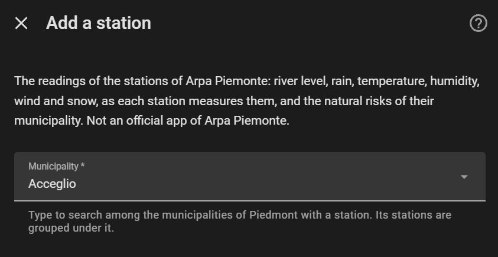
  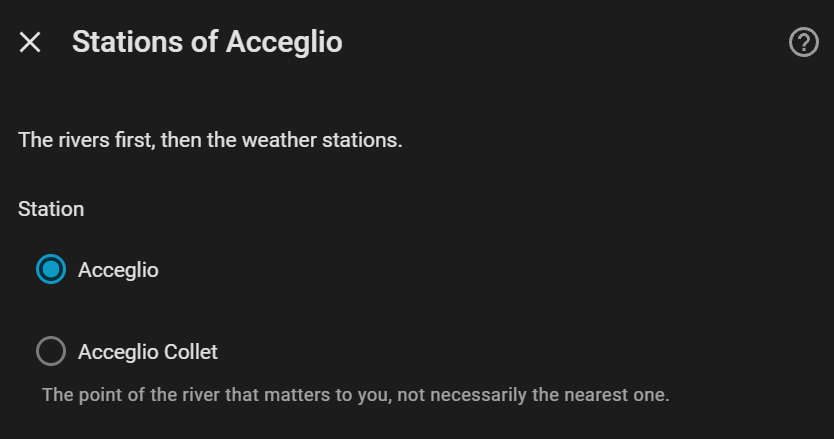
</p>

Chaque commune est une entrée, avec ses stations en dessous, et un appareil
de ses risques naturels à côté. Pour ajouter une autre station d'une commune,
choisissez **Ajouter une station** sur son entrée, ou ajoutez à nouveau
l'intégration et choisissez la même commune.

<p align="center">
  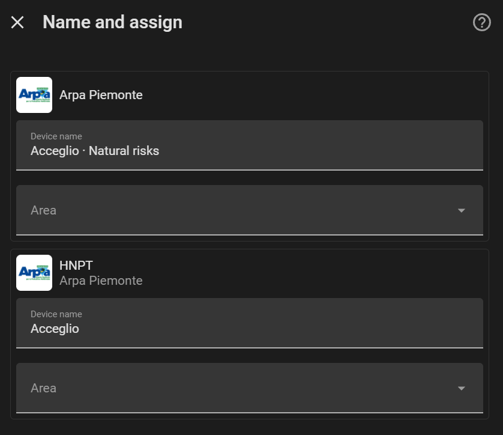
</p>

Pour relire depuis Arpa Piemonte les capteurs et les seuils d'une station,
choisissez **Relire la station** sur la station. **Reconfigurer** sur
l'entrée d'une commune relit toutes ses stations.

### Options

**Configurer** sur l'entrée d'une commune :

| Option | Ce qu'elle fait |
| --- | --- |
| Niveau d'alerte minimal | Le capteur binaire de chaque risque, aujourd'hui et demain, s'active à partir de ce niveau du bulletin : jaune (par défaut), orange ou rouge. |
| Position des risques | D'où sont pris les séismes, le danger d'avalanche et la ville de la canicule la plus proche : les stations de la commune (par défaut ; leur position moyenne), ou le domicile de Home Assistant. |
| Rayon des séismes | Les séismes à moins de cette distance de la position, en km : 50 par défaut, comme le DPC. |
| Ville de la canicule | Arpa publie les bulletins de canicule pour les 8 chefs-lieux de province seulement : le chef-lieu de la province de la commune (par défaut), ou le chef-lieu le plus proche de la position. |

L'intégration lit la position quand la commune est configurée : après avoir
déplacé le domicile de Home Assistant, rechargez la commune.

## Suppression

**Paramètres → Appareils et services → Arpa Piemonte** : **Supprimer** dans
les trois points d'une station la supprime ; dans ceux d'une commune, cela
supprime la commune avec ses stations et ses risques. Pour supprimer
l'intégration, supprimez chaque commune, puis désinstallez-la depuis le
Marketplace.

## Comment les données sont mises à jour

Toutes les 10 minutes, l'intégration demande à Meteo 3R si le fichier de la
station a changé ; la plupart du temps, non, et rien n'est téléchargé.
Meteo 3R publie une mesure toutes les 30 minutes, environ 30 à 45 minutes
après qu'elle a été mesurée.

| Source | Mesures | Retard | Interrogée |
| --- | --- | --- | --- |
| Meteo 3R | toutes les 30 min | ~40 min | toutes les 10 min |
| Fichiers du site d'Arpa (niveau, température, humidité, neige) | toutes les heures | ~40 min | seulement en secours, toutes les 20 min au plus |
| Fichiers du site d'Arpa (pression, rayonnement solaire) | toutes les heures | ~40 min | toutes les 20 min : la seule source |
| api_realtime d'Arpa Piemonte (tout le reste) | toutes les heures | ~3 h 40 min | seulement en secours, toutes les 30 min au plus |

Chaque capteur affiche la mesure la plus récente de toutes les sources ; à
heure égale, celle de Meteo 3R. Une mesure de plus de 6 heures n'est pas
affichée : le capteur devient indisponible. **Source des données** indique
d'où viennent les mesures que Meteo 3R peut donner ; la pression et le
rayonnement solaire viennent toujours du site.

Les risques naturels viennent du widget de la commune sur le site d'Arpa,
interrogé toutes les 10 minutes, la plupart du temps sans téléchargement :
Arpa le reconstruit environ toutes les 10 minutes, mais ses parties changent
moins souvent. Le bulletin d'alerte est publié une fois par jour, vers 13 h,
pour ce jour et le suivant ; le danger actuel est évalué à quelques heures
d'intervalle d'après la pluie et les niveaux des cours d'eau des dernières 24
heures ; la phase opérationnelle change quand la commune en déclare une.
Aujourd'hui et demain sont les jours en Italie : à minuit, demain devient
aujourd'hui, et le nouveau demain est inconnu jusqu'au bulletin suivant.

| Risque | Publié | Interrogé |
| --- | --- | --- |
| Alertes, danger actuel, phase opérationnelle (widget de la commune) | le bulletin une fois par jour, vers 13 h ; le danger à quelques heures d'intervalle | toutes les 10 min |
| Séismes (Arpa) | en quelques minutes à partir de la magnitude 2.5, après révision en dessous | toutes les 10 min |
| Canicules (Arpa, 8 chefs-lieux) | une fois par jour, du 15 mai au 30 septembre environ | toutes les 30 min |
| Avalanches (AINEVA, EAWS) | la veille, vers 17 h, de décembre à mai | toutes les heures ; hors saison, toutes les 6 heures |

La plupart des réponses sont un `304 Not Modified`, sans téléchargement.

## Limitations connues

- L'historique de Home Assistant enregistre une mesure quand elle est
  téléchargée, 30 à 45 minutes après qu'elle a été mesurée. **Dernière
  mesure** donne l'heure de la mesure.
- Seulement les stations du Piémont. Meteo 3R montre aussi celles de la
  Ligurie et de la Vallée d'Aoste, qui appartiennent à d'autres organismes,
  sous d'autres conditions.
- Quand seule l'api_realtime répond, les mesures datent d'environ 4 heures.
- La pression et le rayonnement solaire viennent seulement des fichiers du
  site, toutes les heures : tant qu'il ne répond pas, ils deviennent
  indisponibles après 6 heures, et leurs graphiques gardent leurs dernières
  mesures.
- Avant Home Assistant 2026.3, l'intégration n'affiche aucune icône : elle
  fournit son icône dans son propre dossier, que les versions plus anciennes
  ne lisent pas.
- Les données sont validées automatiquement seulement, et Arpa Piemonte peut
  les corriger plus tard. Un capteur d'une station peut cesser de répondre
  pendant des jours.
- Les seuils sont ceux d'Arpa Piemonte ; tous les limnimètres n'ont pas les
  trois (il en manque au moins un à 26 sur 110).
- Les graphiques montrent seulement les mesures de Meteo 3R : tant qu'il ne
  répond pas, ils gardent ses dernières mesures. Leur texte est gris, plus
  foncé ou plus clair quand le navigateur indique que la page est claire ou
  sombre, quel que soit le thème de Home Assistant.
- Avant Home Assistant 2026.5, le tableau de bord n'est pas listé sous
  **Ajouter un tableau de bord** : ajoutez-le avec son YAML (voir
  [Tableau de bord](#tableau-de-bord)).
- Le tableau de bord lit les seuils à son ouverture : la jauge d'une station
  qui n'avait pas encore répondu apparaît après le rechargement de la page.
- Chaque matin, les risques de demain sont inconnus jusqu'au bulletin du
  jour, vers 13 h, et le tableau de bord les masque.
- Les risques sont ceux que le widget donne à la commune, d'après les zones
  d'alerte où elle se trouve : la plupart sont dans une seule, quelques-unes
  dans deux (Asti, Piem-G et Piem-L). Les avalanches ne sont pas évaluées
  hors saison.
- Le bulletin d'alerte couvre seulement le Piémont : Palestro, une commune de
  Lombardie avec une station d'Arpa Piemonte, n'a pas d'alertes, seulement
  les séismes, les canicules du chef-lieu le plus proche et les avalanches.
- Les canicules sont connues du 15 mai au 30 septembre environ, le danger
  d'avalanche de décembre à mai : hors saison, ils sont inconnus. Le danger
  d'avalanche n'existe que là où la position est dans l'une des 14
  micro-régions des bulletins, les montagnes : pour les stations, celle de
  leur moyenne ou sinon d'une station qui s'y trouve.
- Les séismes sont ceux des 30 derniers jours, de magnitude 1.0 ou plus, dans
  le Piémont et autour ; un séisme en dessous de 2.5 apparaît une fois qu'un
  sismologue l'a révisé, une heure ou plus après.

## Dépannage

- **Un capteur est indisponible** : la station ne l'a pas mesuré depuis 6
  heures, ou aucune source ne répond. Vérifiez la station sur le
  [site d'Arpa Piemonte](https://www.arpa.piemonte.it/rischi_naturali/snippets_arpa_graphs/dettaglio_stazione/)
  (l'appareil renvoie à sa page).
- **Source des données n'est pas Meteo 3R** : Meteo 3R n'a pas répondu ;
  l'intégration y revient dès qu'il répond.
- **La station ne peut pas être ajoutée** : Arpa Piemonte n'a pas répondu ;
  réessayez plus tard.
- **Les risques sont indisponibles** : leur source n'a pas répondu ;
  l'intégration la réinterroge à sa prochaine mise à jour. L'appareil des
  risques renvoie à la page du widget sur le site d'Arpa.
- **Aucune entité de séisme, de canicule ou d'avalanche** : avec la position
  des stations, une commune dont toutes les stations ont été supprimées n'a
  pas de position.
- Sinon, téléchargez les diagnostics (les trois points de la commune sur la
  page de l'intégration, ou la page de l'appareil de la station) et ouvrez
  une [issue](https://github.com/webysther/ha-arpa-piemonte/issues) avec eux
  et un journal de débogage.

## Entités

D'une station, celles de ses capteurs :

| Entité | Unité | D'une station avec |
| --- | --- | --- |
| Niveau hydrométrique | m au-dessus du zéro hydrométrique | limnimètre |
| État du niveau : normal, pré-alarme, garde, danger | | limnimètre |
| Risque de crue (sécurité) : activé à partir du seuil de pré-alarme | | limnimètre avec un seuil |
| Seuil de pré-alarme, de garde et de danger (diagnostic) | m | limnimètre |
| Pluie 1 heure, 3 heures, 24 heures | mm | pluviomètre |
| Température | °C | thermomètre |
| Humidité | % | hygromètre |
| Vitesse du vent, vitesse des rafales | km/h | anémomètre |
| Direction du vent, direction des rafales | ° | anémomètre |
| Hauteur de neige | cm | nivomètre |
| Pression atmosphérique, à la station, pas au niveau de la mer | hPa | baromètre |
| Rayonnement solaire | W/m² | radiomètre |
| Source des données (diagnostic) : Meteo 3R, Site d'Arpa, api_realtime d'Arpa | | chaque station |
| Dernière mesure (diagnostic) | | chaque station |
| Graphique du niveau, de la pluie, de la température, de l'humidité, de la neige, du vent, de la pression, du rayonnement solaire (image) | | le capteur qu'il montre |

Les identifiants d'entité sont en anglais :
`sensor.arpa_piemonte_pray_sessera_level`,
`binary_sensor.arpa_piemonte_pray_sessera_flood_risk`,
`image.arpa_piemonte_pray_sessera_level_chart`.

<p align="center">
  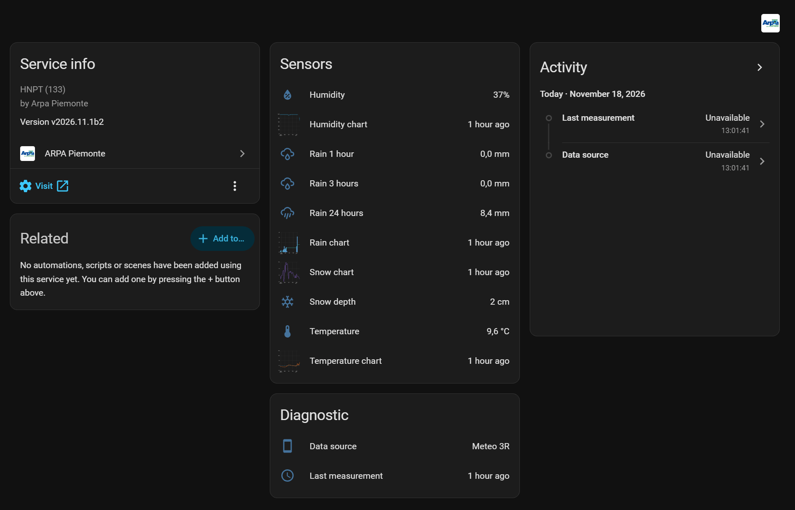
</p>

D'une commune, ses risques naturels, sur l'appareil **Pray · Risques
naturels** :

| Entité | États |
| --- | --- |
| Alerte maximale, d'aujourd'hui et de demain | non évalué, pas d'alerte (vert), alerte jaune, orange ou rouge |
| Danger actuel, d'après la pluie et les cours d'eau mesurés | non évalué, vert, jaune, orange, rouge |
| Phase opérationnelle communale | aucune phase opérationnelle, attention, pré-alarme, alarme |
| Niveau de risque hydrogéologique, hydraulique, d'orages, de neige et d'avalanches, aujourd'hui et demain | comme l'alerte maximale |
| Risque hydrogéologique, hydraulique, d'orages, de neige et d'avalanches, aujourd'hui et demain (sécurité) | activé à partir du niveau d'alerte minimal |
| Zone d'alerte (diagnostic) | la zone du bulletin : `Piem-B` |
| Bulletin d'alerte, prochain bulletin d'alerte (diagnostic) | quand il a été publié, quand le suivant est attendu |
| Séismes à proximité | combien dans le rayon, sur les 30 derniers jours |
| Séisme M 1.9 (géolocalisation), un pour chacun | sa distance, en km ; sa magnitude, son heure, sa profondeur et son district sismique en attributs |
| Canicule aujourd'hui, demain | pas d'inconfort, inconfort de niveau 1, 2 ou 3 (vert à rouge) |
| Ville de la canicule (diagnostic) | le chef-lieu dont c'est le bulletin : `Biella` |
| Danger d'avalanche aujourd'hui, demain | pas de neige, 1 faible, 2 limité, 3 marqué, 4 fort, 5 très fort : le plus élevé du bulletin |
| Micro-région avalanches (diagnostic) | la micro-région de la position : `Valle Stura` |

Leurs identifiants d'entité : `sensor.arpa_piemonte_pray_highest_alert`,
`sensor.arpa_piemonte_pray_hydraulic_risk_level_tomorrow`,
`binary_sensor.arpa_piemonte_pray_hydraulic_risk_tomorrow`,
`geo_location.arpa_piemonte_pray_earthquake_261117064149`. Un risque d'un
jour que le bulletin ne couvre pas encore est inconnu : demain, le matin. Les
séismes, les canicules et les avalanches n'existent que là où la commune les
a : une position, un chef-lieu, une micro-région.

<p align="center">
  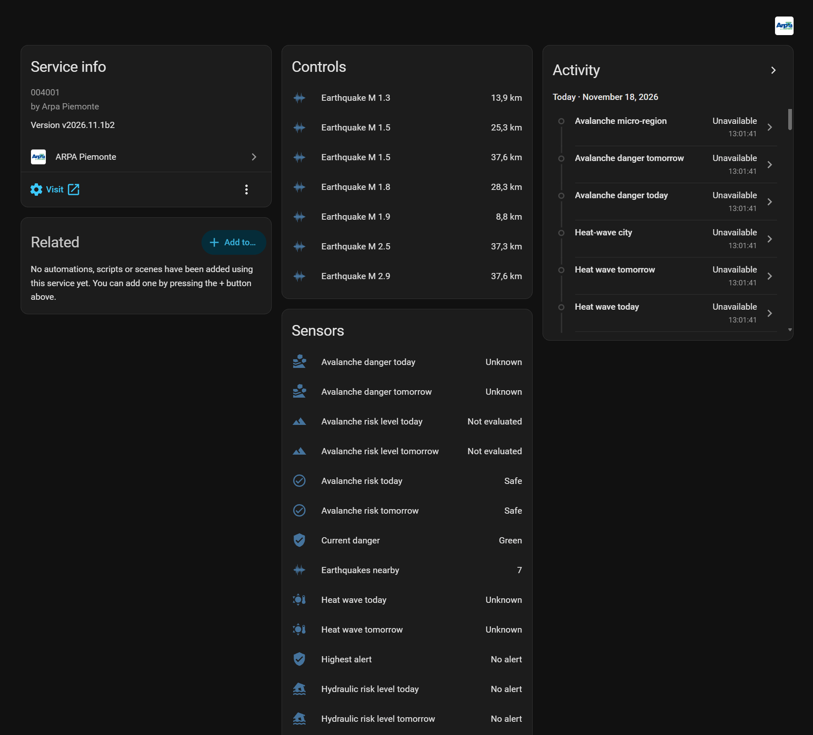
</p>

L'état d'un graphique est l'heure de sa mesure la plus récente. Les
graphiques ne portent pas de mots, seulement des unités et des valeurs : les
lignes pointillées du niveau sont les seuils de pré-alarme (jaune), de garde
(orange) et de danger (rouge), les barres de la pluie sont la pluie de chaque
heure, et la ligne son total sur le graphique (axe de droite, Σ mm) ; les
points du vent sont les rafales. Les graphiques de la pression et du
rayonnement solaire ont une mesure par heure, tirée des fichiers du site, sur
les mêmes jours que les autres.

<p align="center">
  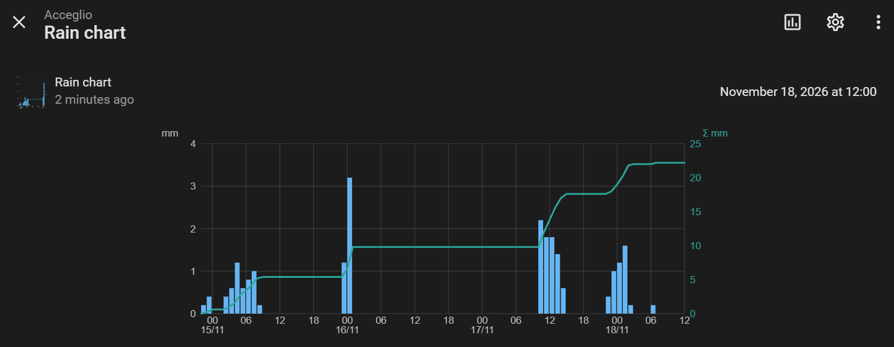
  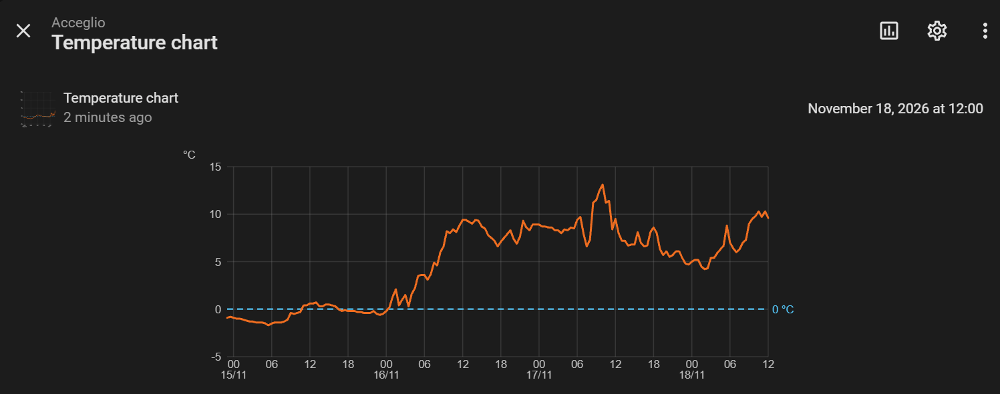
  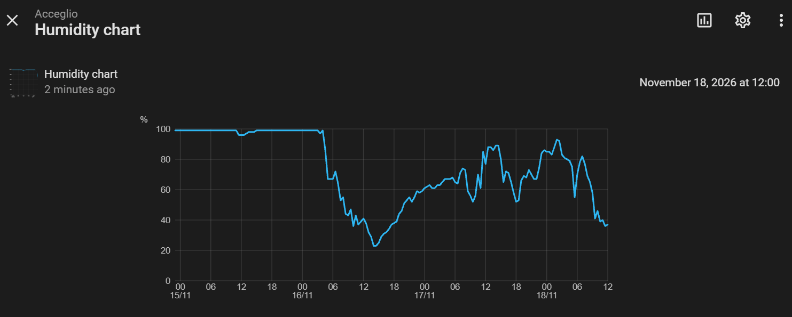
</p>

Les baromètres et les radiomètres sont ceux que nomme la liste des stations
du site d'Arpa : 45 et 64 au 2026-11-17, alors que les lettres des capteurs
dans Meteo 3R en nomment 47 et 66, dont les fichiers sont vides, vieux de
plusieurs années ou absents. Quand cette liste n'a pas répondu à l'ajout
d'une station, les lettres la remplacent : **Relire la station** corrige
cela.

## Exemples d'automatisations

Être averti quand le cours d'eau atteint un seuil :

```yaml
automation:
  - alias: "Sessera au-dessus d'un seuil"
    triggers:
      - trigger: state
        entity_id: binary_sensor.arpa_piemonte_pray_sessera_flood_risk
        to: "on"
    actions:
      - action: notify.notify
        data:
          title: "Sessera à Pray"
          message: >-
            Niveau {{ states('sensor.arpa_piemonte_pray_sessera_level') }} m :
            {{ states('sensor.arpa_piemonte_pray_sessera_level_status') }}
```

Être averti d'une alerte demain, dès que le bulletin est publié :

```yaml
automation:
  - alias: "Alerte demain à Pray"
    triggers:
      - trigger: state
        entity_id:
          - binary_sensor.arpa_piemonte_pray_hydrogeological_risk_tomorrow
          - binary_sensor.arpa_piemonte_pray_hydraulic_risk_tomorrow
          - binary_sensor.arpa_piemonte_pray_thunderstorm_risk_tomorrow
          - binary_sensor.arpa_piemonte_pray_snow_risk_tomorrow
          - binary_sensor.arpa_piemonte_pray_avalanche_risk_tomorrow
        to: "on"
    actions:
      - action: notify.notify
        data:
          title: "Pray : alerte demain"
          message: "{{ trigger.to_state.name }}"
```

Être averti d'un séisme dans le rayon, dès qu'il apparaît :

```yaml
automation:
  - alias: "Séisme près de Pray"
    triggers:
      - trigger: geo_location
        source: arpa_piemonte
        zone: zone.home
        event: enter
    actions:
      - action: notify.notify
        data:
          message: >-
            {{ trigger.to_state.name }},
            à {{ trigger.to_state.state }} km
```

Le déclencheur se déclenche pour un séisme à l'intérieur de la zone, dont le
rayon est de 100 m sauf si vous le changez : donnez-lui le rayon que vous
voulez, ou déclenchez plutôt sur la hausse de
`sensor.arpa_piemonte_pray_nearby_earthquakes`.

Être averti quand le cours d'eau monte vite :

```yaml
automation:
  - alias: "Sessera en hausse"
    triggers:
      - trigger: numeric_state
        entity_id: sensor.arpa_piemonte_pray_sessera_level
        above: 1.5
    actions:
      - action: notify.notify
        data:
          message: "Le Sessera à Pray dépasse 1.5 m"
```

## Tableau de bord

L'intégration est fournie avec un tableau de bord fait des cartes de Home
Assistant, avec les noms des entités dans la langue de chaque utilisateur. Il
a un onglet pour chaque commune, dont la première section est celle de ses
**risques naturels** : la zone d'alerte, l'heure du bulletin, la ville de la
canicule et la micro-région ; l'alerte maximale et le danger actuel aux
couleurs des cartes d'alerte, la phase opérationnelle aux couleurs du widget
d'Arpa ; le niveau de chaque risque, la canicule et le danger d'avalanche,
aujourd'hui et demain, chacun tant que son bulletin couvre le jour ; et les
séismes à proximité, sur une carte marquée de leur magnitude.

Puis une section pour chaque station, les limnimètres d'abord :

<p align="center">
  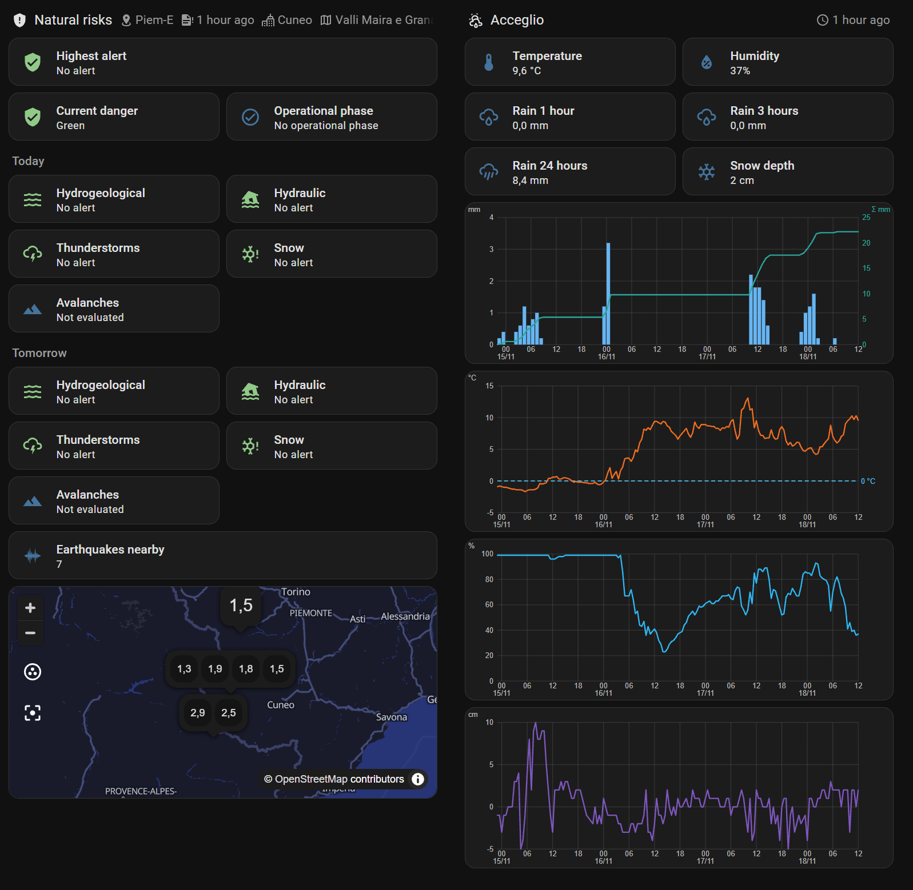
</p>

- **L'en-tête** : le nom de la station, son risque de crue à la couleur de
  son niveau, l'heure de sa dernière mesure et, tant que ce n'est pas
  Meteo 3R, la source de ses mesures.
- **Le niveau** d'un limnimètre : son état aux couleurs des cartes d'alerte,
  vert, jaune, orange et rouge, et une jauge avec une bande au-dessus de
  chaque seuil, de 0 au seuil le plus haut plus un quart (Pray Sessera, avec
  2.3, 3.0 et 3.8 m, va jusqu'à 4.75 m). Un limnimètre sans seuils affiche
  son niveau.
- **Les mesures** : température, humidité, les trois pluies, vent, rafale et
  neige, selon ce que mesure la station.
- **Les graphiques**, dès que Meteo 3R a donné les mesures de la station.

Pour l'ajouter, à partir de Home Assistant 2026.5 :

1. Allez dans **Paramètres → Tableaux de bord → Ajouter un tableau de bord**.
2. Choisissez **Arpa Piemonte**. S'il n'apparaît pas, rechargez la page.

Avant Home Assistant 2026.5 :

1. Allez dans **Paramètres → Tableaux de bord → Ajouter un tableau de bord →
   Nouveau tableau de bord vide**, et ouvrez-le.
2. Choisissez **⋮ → Modifier le tableau de bord**, puis **⋮ → Éditeur de
   configuration brute**.
3. Remplacez son contenu par :

   ```yaml
   strategy:
     type: custom:arpa-piemonte
   ```

Le tableau de bord suit vos stations et les noms que vous donnez à leurs
appareils : à partir de Home Assistant 2026.7, il change de lui-même quand
vous en ajoutez ou en supprimez une ; avant, quand vous rechargez la page.
Pour afficher les stations d'une commune dans un autre tableau de bord,
ajoutez une vue avec la stratégie et l'ID de l'entrée de la commune
(`entry_id`, dans ses diagnostics) :

```yaml
views:
  - title: Pray
    strategy:
      type: custom:arpa-piemonte
      entry_id: 01JCQK3Z5T3K8W6B2V4M9H7XNE
```

## Carte

La carte d'une station, dans le sélecteur de cartes dès que l'intégration est
installée : recherchez **Arpa Piemonte** (`custom:arpa-piemonte-card`). C'est
la section de la station dans le tableau de bord, en une seule carte faite
des cartes de Home Assistant : elle trouve les entités de la station même
après que vous les avez renommées, colore l'état du niveau et le risque de
crue selon le niveau, et affiche les graphiques qui ont des données.

<p align="center">
  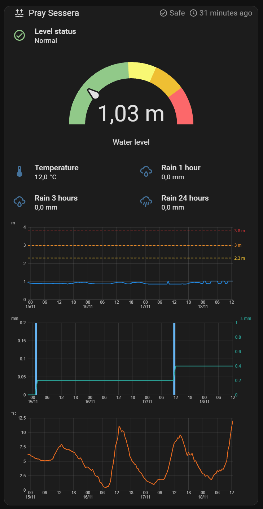
</p>

L'éditeur visuel choisit la station et ce que la carte affiche. En YAML, une
option omise affiche tout :

| Option | Sans elle |
| --- | --- |
| `device_id` | La première station. L'ID de l'appareil de la station, la fin de l'adresse de sa page d'appareil. |
| `show_title: false` | Le nom de la station, au-dessus du reste. Sans lui, les badges passent au début. |
| `show_flood_risk: false` | Le risque de crue, à la couleur du niveau, à côté du nom. |
| `show_last_measurement: false` | L'heure de la dernière mesure, à côté du nom. |
| `show_level: false` | L'état du niveau et sa jauge. |
| `show_readings: false` | Les mesures. |
| `show_charts: false` | Les graphiques. |
| `columns: 1` | Les mesures sur deux colonnes. |

```yaml
# Le niveau de Pray Sessera et ses graphiques, sans les mesures
type: custom:arpa-piemonte-card
device_id: 0123456789abcdef0123456789abcdef
show_readings: false
```

Un graphique seul, avec les cartes de Home Assistant :

```yaml
type: picture-entity
entity: image.arpa_piemonte_pray_sessera_level_chart
show_name: false
show_state: false
```

## Source des données et attribution

Les données sont d'**Arpa Piemonte**, sous la licence
[Creative Commons Attribution 4.0](https://creativecommons.org/licenses/by/4.0/)
([mentions légales](https://www.arpa.piemonte.it/note-legali)) : « Fonte: Arpa
Piemonte - www.arpa.piemonte.it ». Chaque entité porte cette attribution, et
chaque appareil renvoie à la page de sa station ou, pour les risques
naturels, à la page du widget de la commune, où Arpa les affiche.

Les bulletins d'avalanche sont ceux d'AINEVA pour le Piémont, tels que les
European Avalanche Warning Services (EAWS) les publient, « Fonte: AINEVA
Piemonte - bollettini.aineva.it », que portent leurs entités ; leurs
micro-régions sont celles d'EAWS (CC0). Sans lien avec AINEVA ni EAWS.

L'intégration lit Meteo 3R avec
[aiometeo3r](https://github.com/webysther/aio-meteo3r) et les sources
officielles avec
[aioarpapiemonte](https://github.com/webysther/aio-arpa-piemonte).

## Contribuer

Voir [CONTRIBUTING.md](https://github.com/webysther/ha-arpa-piemonte/blob/main/CONTRIBUTING.md)
(en anglais).

## Licence

Le code d'Arpa Piemonte est sous
[licence MIT](https://github.com/webysther/ha-arpa-piemonte/blob/main/LICENSE.md).
Les mesures sont des données d'Arpa Piemonte, sous licence
[CC BY 4.0](https://creativecommons.org/licenses/by/4.0/) : chaque entité
porte cette attribution.

Les noms, logos et marques de ce dépôt, comme ceux d'Arpa Piemonte, de
Meteo 3R et de Home Assistant, appartiennent à leurs propriétaires et ne
servent qu'à les identifier, sans impliquer leur approbation. Ils ne sont
couverts ni par la licence du code ni par la licence CC BY 4.0 des données.
