<p align="center">
  <picture>
    <source media="(prefers-color-scheme: dark)" srcset="https://raw.githubusercontent.com/webysther/ha-arpa-piemonte/main/custom_components/arpa_piemonte/brand/dark_icon@2x.png">
    
  </picture>
</p>

<h1 align="center">Arpa Piemonte</h1>

<p align="center">Livelli dei fiumi, pioggia, temperatura, vento e neve delle stazioni di Arpa Piemonte, e i rischi naturali dei loro comuni, in Home Assistant</p>

<p align="center">
  <a href="https://github.com/webysther/ha-arpa-piemonte/releases/latest"></a>
  <a href="https://www.home-assistant.io/integrations/marketplace/"></a>
  <a href="https://github.com/webysther/ha-arpa-piemonte/actions/workflows/tests.yaml"></a>
  <a href="https://github.com/webysther/ha-arpa-piemonte/blob/main/LICENSE.md"></a>
</p>

<p align="center"><a href="https://github.com/webysther/ha-arpa-piemonte/blob/main/README.md">English</a> · <b>Italiano</b> · <a href="https://github.com/webysther/ha-arpa-piemonte/blob/main/README.fr.md">Français</a> · <a href="https://github.com/webysther/ha-arpa-piemonte/blob/main/README.es.md">Español</a> · <a href="https://github.com/webysther/ha-arpa-piemonte/blob/main/README.de.md">Deutsch</a></p>

Le misure delle stazioni di [Arpa Piemonte](https://www.arpa.piemonte.it)
in Home Assistant: i **livelli dei fiumi**, con le soglie di allerta di ogni
idrometro, la **pioggia**, la temperatura, l'umidità, il vento e la neve, per
una qualsiasi delle 374 stazioni della rete del Piemonte; e i **rischi
naturali** dei loro comuni: le allerte del bollettino di oggi e domani, il
pericolo attuale, la fase operativa comunale, i terremoti vicini, le ondate di
calore e il pericolo valanghe.

> Non è un'app ufficiale di Arpa Piemonte, né approvata da essa. I dati sono
> validati solo automaticamente. Non farci affidamento per la sicurezza: per
> le allerte, segui i bollettini ufficiali e la protezione civile.

<p align="center">
  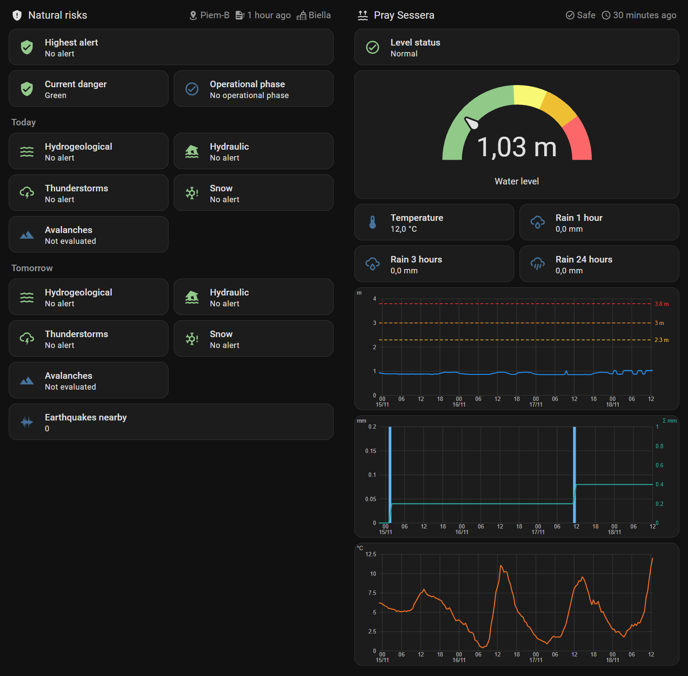
</p>

## Funzionalità

- Un dispositivo per stazione, con i sensori che ha: un idrometro ha il suo
  livello idrometrico, il suo stato rispetto alle soglie (normale, preallarme,
  guardia, pericolo) e un rischio di piena, acceso dalla soglia di preallarme;
  una stazione meteo la sua pioggia, temperatura, umidità, vento e neve, e con
  un barometro o un radiometro, la pressione atmosferica e la radiazione
  solare.
- Le stazioni raggruppate per comune: una voce per comune, con le sue stazioni
  sotto di essa.
- Le misure più fresche: quelle dell'app Meteo 3R di Arpa Piemonte, ogni 30
  minuti.
- Quando Meteo 3R non risponde, o una sua misura è troppo vecchia, subentrano
  le fonti ufficiali di Arpa Piemonte: i file del suo sito, poi la sua
  api_realtime. Il sensore **Fonte dei dati** dice quale viene mostrata.
- L'ora della misura, non dello scaricamento: **Ultima misura**.
- Grafici degli ultimi 3-4 giorni, come immagini: il livello con le sue
  soglie, la pioggia di ogni ora con il suo totale, temperatura, umidità, neve,
  vento, pressione e radiazione solare. L'integrazione li disegna dalle misure
  che ha già.
- I rischi naturali di ogni comune, su un dispositivo a parte, come li dà il
  widget del comune sul sito di Arpa: il livello di ogni rischio del bollettino
  di allerta (idrogeologico, idraulico, temporali, neve, valanghe) oggi e
  domani, ciascuno con un sensore binario di sicurezza acceso dal livello di
  allerta che scegli; l'allerta massima; il pericolo attuale, dalla pioggia e
  dai fiumi misurati; e la fase operativa che il comune ha dichiarato.
- I terremoti degli ultimi 30 giorni vicino al comune, o vicino a casa tua,
  sulla mappa; le ondate di calore del capoluogo della sua provincia, o del più
  vicino, d'estate; e il pericolo valanghe della sua microregione, dai
  bollettini di AINEVA, d'inverno.
- Una [plancia](#plancia): una vista per comune, con i suoi rischi in alto e
  una sezione per stazione, il livello nei colori delle mappe di allerta e un
  indicatore con le sue soglie; e una [scheda](#scheda) di una stazione, nel
  selettore delle schede.

## Casi d'uso

- Essere avvisati quando il fiume vicino a casa raggiunge la soglia di
  preallarme, prima dei bollettini ufficiali.
- Essere avvisati nel pomeriggio quando il bollettino mette il tuo comune in
  allerta arancione per domani, o quando il comune dichiara una fase
  operativa.
- Essere avvisati di un terremoto entro 50 km da casa.
- Chiudere le tapparelle presto in un giorno di disagio per il caldo, o
  controllare il pericolo valanghe prima di salire in valle.
- Seguire la pioggia delle ultime 24 ore a monte di un fiume.
- Chiudere le tapparelle quando il vento soffia a raffiche, coprire le piante
  quando gela.

## Installazione

Dal [Marketplace](https://www.home-assistant.io/integrations/marketplace/)
di Home Assistant:

[](https://my.home-assistant.io/redirect/marketplace_repository/?owner=webysther&repository=ha-arpa-piemonte&category=integration)

1. Apri il link qui sopra, oppure
   **Impostazioni → Marketplace → Aggiungi dal collegamento**, e aggiungi
   `https://github.com/webysther/ha-arpa-piemonte`.
2. Apri **Arpa Piemonte** e installala.

Home Assistant 2025.4 o successivo.

## Configurazione

**Impostazioni → Dispositivi e servizi → Aggiungi integrazione → Arpa Piemonte**,
poi scrivi il comune della stazione: l'elenco ha i 278 comuni del Piemonte con
una stazione, e trova "Mondovì" come lo scrive Arpa Piemonte, "Mondovi'".
Quando il comune ha più stazioni, scegline una: prima i corsi d'acqua, poi le
stazioni meteo. Scegli il punto del fiume che ti interessa, non per forza il
più vicino.

<p align="center">
  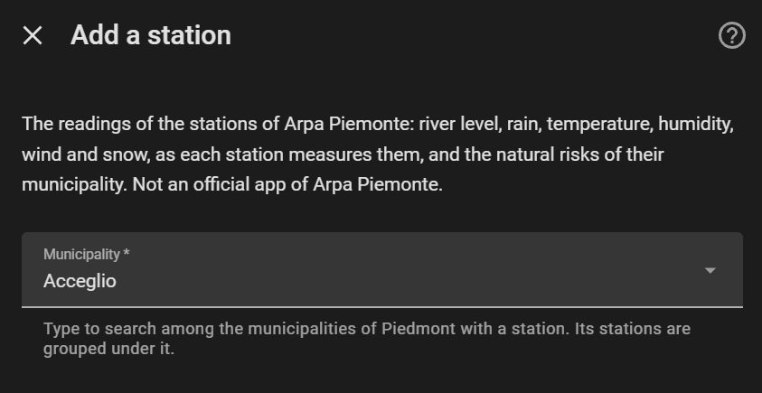
  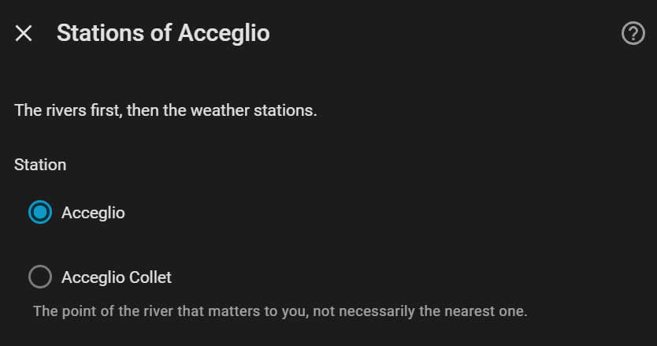
</p>

Ogni comune è una voce, con le sue stazioni sotto di essa, e accanto a loro un
dispositivo dei suoi rischi naturali. Per aggiungere un'altra stazione di un
comune, scegli **Aggiungi stazione** sulla sua voce, oppure aggiungi di nuovo
l'integrazione e scegli lo stesso comune.

<p align="center">
  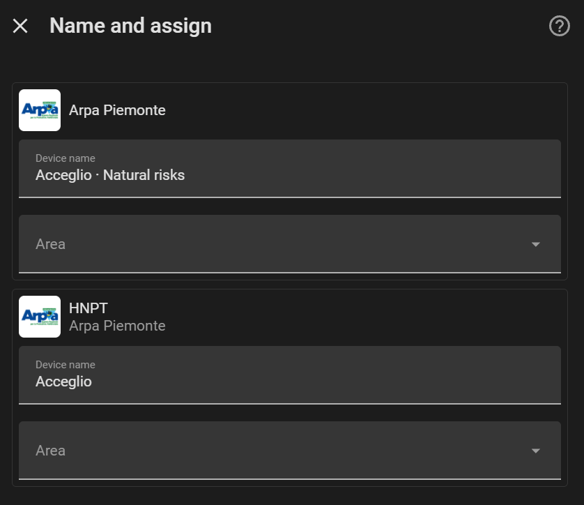
</p>

Per rileggere da Arpa Piemonte i sensori e le soglie di una stazione, scegli
**Rileggi la stazione** sulla stazione. **Riconfigura** sulla voce di un
comune rilegge tutte le sue stazioni.

### Opzioni

**Configura** sulla voce di un comune:

| Opzione | Cosa fa |
| --- | --- |
| Livello minimo di allerta | Il sensore binario di ogni rischio, oggi e domani, si accende da questo livello del bollettino: allerta gialla (predefinito), arancione o rossa. |
| Posizione dei rischi | Da dove vengono presi i terremoti, il pericolo valanghe e la città delle ondate di calore più vicina: le stazioni del comune (predefinito; la loro posizione media), o la casa di Home Assistant. |
| Raggio dei terremoti | I terremoti entro questa distanza dalla posizione, in km: 50 per impostazione predefinita, come il DPC. |
| Città delle ondate di calore | Arpa emette i bollettini delle ondate di calore solo per gli 8 capoluoghi di provincia: il capoluogo della provincia del comune (predefinito), o il capoluogo più vicino alla posizione. |

L'integrazione legge la posizione quando il comune viene configurato: dopo
aver spostato la casa di Home Assistant, ricarica il comune.

## Rimozione

**Impostazioni → Dispositivi e servizi → Arpa Piemonte**: **Elimina** nei tre
puntini di una stazione la rimuove; in quelli di un comune, rimuove il comune
con le sue stazioni e i suoi rischi. Per rimuovere l'integrazione, elimina
ogni comune, poi disinstallala dal Marketplace.

## Come vengono aggiornati i dati

Ogni 10 minuti, l'integrazione chiede a Meteo 3R se il file della stazione è
cambiato; il più delle volte non lo è, e non viene scaricato nulla. Meteo 3R
pubblica una misura ogni 30 minuti, circa 30-45 minuti dopo che è stata
rilevata.

| Fonte | Misure | In ritardo di | Interrogata |
| --- | --- | --- | --- |
| Meteo 3R | ogni 30 min | ~40 min | ogni 10 min |
| File del sito di Arpa (livello, temperatura, umidità, neve) | ogni ora | ~40 min | solo come riserva, al massimo ogni 20 min |
| File del sito di Arpa (pressione, radiazione solare) | ogni ora | ~40 min | ogni 20 min: l'unica fonte |
| api_realtime di Arpa Piemonte (tutto il resto) | ogni ora | ~3 h 40 min | solo come riserva, al massimo ogni 30 min |

Ogni sensore mostra la misura più recente di tutte le fonti; a parità di ora,
quella di Meteo 3R. Una misura più vecchia di 6 ore non viene mostrata: il
sensore diventa non disponibile. **Fonte dei dati** dice da dove vengono le
misure che Meteo 3R può dare; la pressione e la radiazione solare vengono
sempre dal sito.

I rischi naturali vengono dal widget del comune sul sito di Arpa, interrogato
ogni 10 minuti, il più delle volte senza scaricare nulla: Arpa lo ricostruisce
circa ogni 10 minuti, ma le sue parti cambiano meno spesso. Il bollettino di
allerta viene emesso una volta al giorno, verso le 13:00, per quel giorno e il
successivo; il pericolo attuale viene valutato ogni poche ore dalla pioggia e
dai livelli dei fiumi delle ultime 24 ore; la fase operativa cambia quando il
comune ne dichiara una. Oggi e domani sono i giorni in Italia: a mezzanotte,
domani diventa oggi, e il nuovo domani è sconosciuto fino al bollettino
successivo.

| Rischio | Emesso | Interrogato |
| --- | --- | --- |
| Allerte, pericolo attuale, fase operativa (widget del comune) | il bollettino una volta al giorno, verso le 13:00; il pericolo ogni poche ore | ogni 10 min |
| Terremoti (Arpa) | entro pochi minuti da magnitudo 2.5, dopo la revisione al di sotto | ogni 10 min |
| Ondate di calore (Arpa, 8 capoluoghi) | una volta al giorno, dal 15 maggio a circa il 30 settembre | ogni 30 min |
| Valanghe (AINEVA, EAWS) | il giorno prima, verso le 17:00, da dicembre a maggio | ogni ora; fuori stagione, ogni 6 ore |

La maggior parte delle risposte è un `304 Not Modified`, senza scaricamento.

## Limitazioni note

- La cronologia di Home Assistant registra una misura quando viene scaricata,
  30-45 minuti dopo che è stata rilevata. **Ultima misura** dà l'ora della
  misura.
- Solo le stazioni del Piemonte. Meteo 3R mostra anche quelle della Liguria e
  della Valle d'Aosta, che appartengono ad altri enti, con altre condizioni.
- Quando risponde solo l'api_realtime, le misure hanno circa 4 ore.
- La pressione e la radiazione solare vengono solo dai file del sito, ogni ora:
  finché non risponde, diventano non disponibili dopo 6 ore, mentre i loro
  grafici mantengono le ultime misure.
- Prima di Home Assistant 2026.3, l'integrazione non mostra alcuna icona:
  fornisce la sua icona nella propria cartella, che le versioni precedenti non
  leggono.
- I dati sono validati solo automaticamente, e Arpa Piemonte può correggerli
  in seguito. Un sensore di una stazione può smettere di rispondere per giorni.
- Le soglie sono quelle di Arpa Piemonte; non tutti gli idrometri le hanno
  tutte e tre (a 26 su 110 ne manca almeno una).
- I grafici mostrano solo le misure di Meteo 3R: finché non risponde,
  mantengono le sue ultime misure. Il loro testo è grigio, più scuro o più
  chiaro quando il browser dice che la pagina è chiara o scura, qualunque sia
  il tema di Home Assistant.
- Prima di Home Assistant 2026.5, la plancia non è elencata in
  **Aggiungi plancia**: aggiungila con il suo YAML (vedi [Plancia](#plancia)).
- La plancia legge le soglie quando si apre: l'indicatore di una stazione che
  non aveva ancora risposto compare dopo aver ricaricato la pagina.
- Ogni mattina, i rischi di domani sono sconosciuti fino al bollettino del
  giorno, verso le 13:00, e la plancia li nasconde.
- I rischi sono quelli che il widget dà al comune, dalle zone di allerta in cui
  si trova: la maggior parte è in una, alcuni in due (Asti, Piem-G e Piem-L).
  Le valanghe non vengono valutate fuori stagione.
- Il bollettino di allerta copre solo il Piemonte: Palestro, un comune della
  Lombardia con una stazione di Arpa Piemonte, non ha allerte, solo i
  terremoti, le ondate di calore del capoluogo più vicino e le valanghe.
- Le ondate di calore sono note dal 15 maggio a circa il 30 settembre, il
  pericolo valanghe da dicembre a maggio: fuori stagione, sono sconosciuti. Il
  pericolo valanghe esiste solo dove la posizione è in una delle 14
  microregioni dei bollettini, le montagne: per le stazioni, quella della loro
  media o altrimenti quella di una stazione che vi si trova.
- I terremoti sono quelli degli ultimi 30 giorni, di magnitudo 1.0 o più, in
  Piemonte e dintorni; un terremoto sotto 2.5 compare quando un sismologo lo
  ha rivisto, un'ora o più dopo.

## Risoluzione dei problemi

- **Un sensore non è disponibile**: la stazione non lo misura da 6 ore, o
  nessuna fonte risponde. Controlla la stazione sul
  [sito di Arpa Piemonte](https://www.arpa.piemonte.it/rischi_naturali/snippets_arpa_graphs/dettaglio_stazione/)
  (il dispositivo rimanda alla sua pagina).
- **Fonte dei dati non è Meteo 3R**: Meteo 3R non ha risposto; l'integrazione
  torna a usarlo appena risponde.
- **La stazione non può essere aggiunta**: Arpa Piemonte non ha risposto;
  riprova più tardi.
- **I rischi non sono disponibili**: la loro fonte non ha risposto;
  l'integrazione chiede di nuovo al suo prossimo aggiornamento. Il dispositivo
  dei rischi rimanda alla pagina del widget sul sito di Arpa.
- **Nessuna entità di terremoti, ondate di calore o valanghe**: con la
  posizione delle stazioni, un comune le cui stazioni sono state tutte rimosse
  non ha una posizione.
- Altrimenti, scarica la diagnostica (i tre puntini del comune nella pagina
  dell'integrazione, o la pagina del dispositivo della stazione) e apri una
  [segnalazione](https://github.com/webysther/ha-arpa-piemonte/issues) con la
  diagnostica e un log di debug.

## Entità

Di ogni stazione, quelle dei suoi sensori:

| Entità | Unità | Di una stazione con |
| --- | --- | --- |
| Livello idrometrico | m sopra lo zero idrometrico | idrometro |
| Stato del livello: normale, preallarme, guardia, pericolo | | idrometro |
| Rischio di piena (sicurezza): acceso dalla soglia di preallarme | | idrometro con una soglia |
| Soglia di preallarme, di guardia e di pericolo (diagnostica) | m | idrometro |
| Pioggia 1 ora, 3 ore, 24 ore | mm | pluviometro |
| Temperatura | °C | termometro |
| Umidità | % | igrometro |
| Velocità del vento, velocità della raffica | km/h | anemometro |
| Direzione del vento, direzione della raffica | ° | anemometro |
| Altezza neve | cm | nivometro |
| Pressione atmosferica, alla stazione, non al livello del mare | hPa | barometro |
| Radiazione solare | W/m² | radiometro |
| Fonte dei dati (diagnostica): Meteo 3R, Sito di Arpa, api_realtime di Arpa | | ogni stazione |
| Ultima misura (diagnostica) | | ogni stazione |
| Grafico del livello, della pioggia, della temperatura, dell'umidità, della neve, del vento, della pressione, della radiazione solare (immagine) | | il sensore che mostra |

Gli ID delle entità sono in inglese: `sensor.arpa_piemonte_pray_sessera_level`,
`binary_sensor.arpa_piemonte_pray_sessera_flood_risk`,
`image.arpa_piemonte_pray_sessera_level_chart`.

<p align="center">
  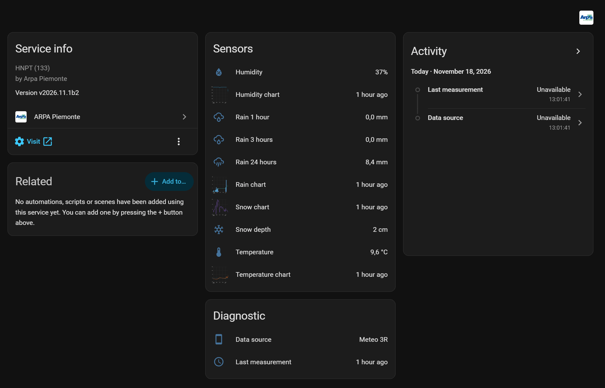
</p>

Di ogni comune, i suoi rischi naturali, sul dispositivo
**Pray · Rischi naturali**:

| Entità | Stati |
| --- | --- |
| Allerta massima, di oggi e domani | non valutato, nessuna allerta (verde), allerta gialla, arancione o rossa |
| Pericolo attuale, dalla pioggia e dai fiumi misurati | non valutato, verde, giallo, arancione, rosso |
| Fase operativa comunale | nessuna fase operativa, attenzione, preallarme, allarme |
| Livello di rischio idrogeologico, idraulico, temporali, neve e valanghe, oggi e domani | come l'allerta massima |
| Rischio idrogeologico, idraulico, temporali, neve e valanghe, oggi e domani (sicurezza) | acceso dal livello minimo di allerta |
| Zona di allerta (diagnostica) | la zona del bollettino: `Piem-B` |
| Bollettino di allerta, prossimo bollettino di allerta (diagnostica) | quando è stato emesso, quando è atteso il prossimo |
| Terremoti vicini | quanti entro il raggio, negli ultimi 30 giorni |
| Terremoto M 1.9 (geolocalizzazione), uno per ciascuno | la sua distanza, in km; magnitudo, ora, profondità e distretto sismico come attributi |
| Ondata di calore oggi, domani | nessun disagio, disagio di livello 1, 2 o 3 (da verde a rosso) |
| Città delle ondate di calore (diagnostica) | il capoluogo di cui è il bollettino: `Biella` |
| Pericolo valanghe oggi, domani | senza neve, 1 debole, 2 moderato, 3 marcato, 4 forte, 5 molto forte: il più alto del bollettino |
| Microregione valanghe (diagnostica) | la microregione della posizione: `Valle Stura` |

I loro ID di entità: `sensor.arpa_piemonte_pray_highest_alert`,
`sensor.arpa_piemonte_pray_hydraulic_risk_level_tomorrow`,
`binary_sensor.arpa_piemonte_pray_hydraulic_risk_tomorrow`,
`geo_location.arpa_piemonte_pray_earthquake_261117064149`. Un rischio di un
giorno che il bollettino non copre ancora è sconosciuto: domani, al mattino. I
terremoti, le ondate di calore e le valanghe esistono solo dove il comune li
ha: una posizione, un capoluogo, una microregione.

<p align="center">
  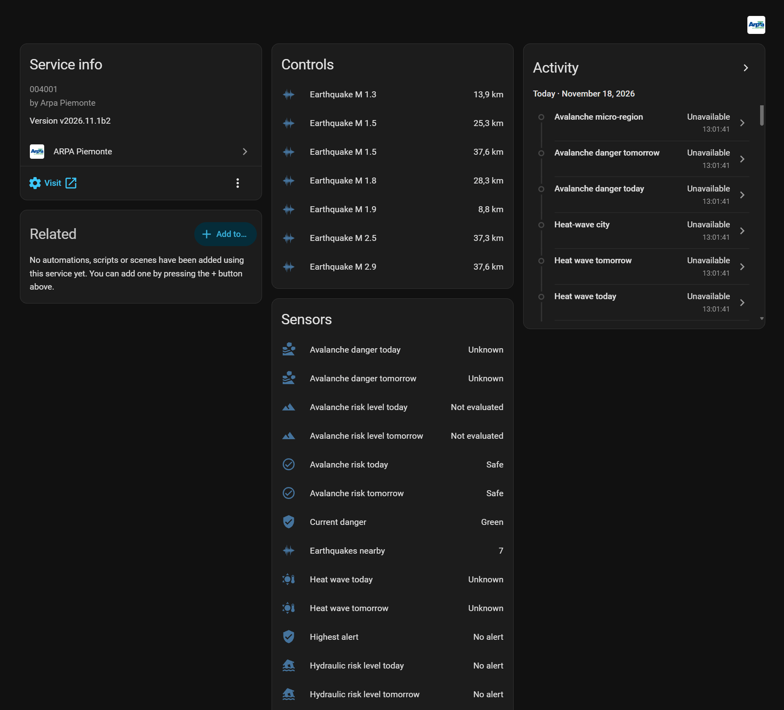
</p>

Lo stato di un grafico è l'ora della sua misura più recente. I grafici non
hanno parole, solo unità e valori: le linee tratteggiate del livello sono le
soglie di preallarme (gialla), di guardia (arancione) e di pericolo (rossa),
le barre della pioggia sono la pioggia di ogni ora, e la linea il suo totale
sul grafico (asse destro, Σ mm); i punti del vento sono le raffiche. I grafici
della pressione e della radiazione solare hanno una misura ogni ora, dai file
del sito, sugli stessi giorni degli altri.

<p align="center">
  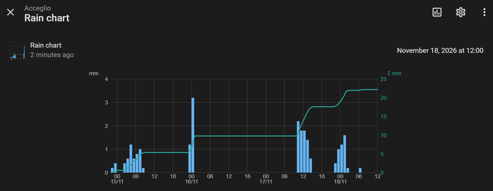
  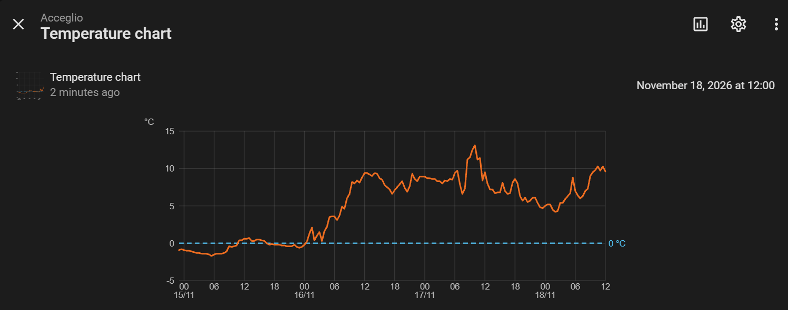
  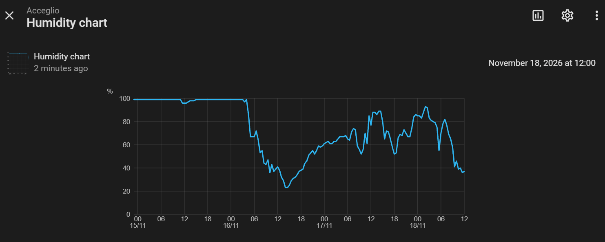
</p>

I barometri e i radiometri sono quelli che nomina l'elenco delle stazioni del
sito di Arpa: 45 e 64 al 2026-11-17, mentre le lettere dei sensori in Meteo 3R
ne nominano 47 e 66, i cui file sono vuoti, vecchi di anni o mancanti. Quando
quell'elenco non ha risposto mentre una stazione veniva aggiunta, le lettere
ne fanno le veci: **Rileggi la stazione** lo corregge.

## Esempi di automazioni

Avvisa quando il fiume raggiunge una soglia:

```yaml
automation:
  - alias: "Sessera sopra una soglia"
    triggers:
      - trigger: state
        entity_id: binary_sensor.arpa_piemonte_pray_sessera_flood_risk
        to: "on"
    actions:
      - action: notify.notify
        data:
          title: "Sessera a Pray"
          message: >-
            Livello {{ states('sensor.arpa_piemonte_pray_sessera_level') }} m:
            {{ states('sensor.arpa_piemonte_pray_sessera_level_status') }}
```

Avvisa di un'allerta per domani, appena viene emesso il bollettino:

```yaml
automation:
  - alias: "Allerta domani a Pray"
    triggers:
      - trigger: state
        entity_id:
          - binary_sensor.arpa_piemonte_pray_hydrogeological_risk_tomorrow
          - binary_sensor.arpa_piemonte_pray_hydraulic_risk_tomorrow
          - binary_sensor.arpa_piemonte_pray_thunderstorm_risk_tomorrow
          - binary_sensor.arpa_piemonte_pray_snow_risk_tomorrow
          - binary_sensor.arpa_piemonte_pray_avalanche_risk_tomorrow
        to: "on"
    actions:
      - action: notify.notify
        data:
          title: "Pray: allerta domani"
          message: "{{ trigger.to_state.name }}"
```

Avvisa di un terremoto entro il raggio, appena compare:

```yaml
automation:
  - alias: "Terremoto vicino a Pray"
    triggers:
      - trigger: geo_location
        source: arpa_piemonte
        zone: zone.home
        event: enter
    actions:
      - action: notify.notify
        data:
          message: >-
            {{ trigger.to_state.name }},
            a {{ trigger.to_state.state }} km di distanza
```

Il trigger scatta per un terremoto all'interno della zona, il cui raggio è di
100 m se non lo cambi: dalle il raggio che vuoi, oppure usa come trigger
l'aumento di `sensor.arpa_piemonte_pray_nearby_earthquakes`.

Avvisa quando il fiume sale in fretta:

```yaml
automation:
  - alias: "Sessera in crescita"
    triggers:
      - trigger: numeric_state
        entity_id: sensor.arpa_piemonte_pray_sessera_level
        above: 1.5
    actions:
      - action: notify.notify
        data:
          message: "Il Sessera a Pray è sopra 1.5 m"
```

## Plancia

L'integrazione include una plancia fatta con le schede di Home Assistant, con
i nomi delle entità nella lingua di ogni utente. Ha una vista per ogni comune,
la cui prima sezione sono i suoi **rischi naturali**: la zona di allerta, l'ora
del bollettino, la città delle ondate di calore e la microregione; l'allerta
massima e il pericolo attuale nei colori delle mappe di allerta, la fase
operativa nei colori del widget di Arpa; il livello di ogni rischio, il caldo
e il pericolo valanghe, oggi e domani, ciascuno finché il suo bollettino copre
il giorno; e i terremoti vicini, su una mappa, segnati con la loro magnitudo.

Poi una sezione per ogni stazione, prima gli idrometri:

<p align="center">
  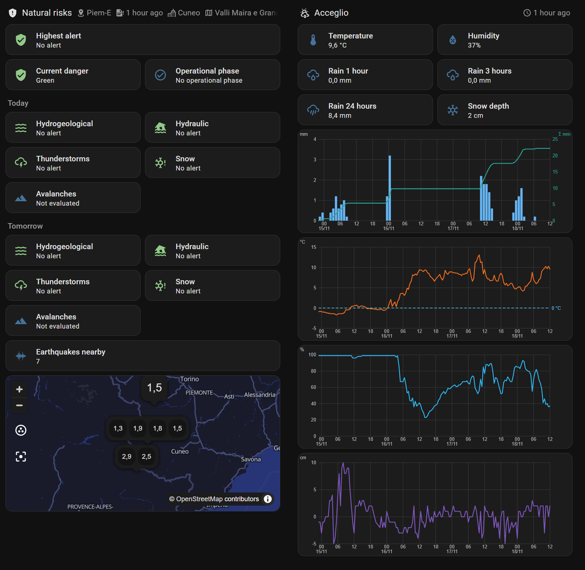
</p>

- **L'intestazione**: il nome della stazione, il suo rischio di piena nel
  colore del suo livello, l'ora della sua ultima misura e, quando non è
  Meteo 3R, la fonte delle sue misure.
- **Il livello** di un idrometro: il suo stato nei colori delle mappe di
  allerta, verde, giallo, arancione e rosso, e un indicatore con una fascia
  sopra ogni soglia, da 0 alla soglia più alta più un quarto (Pray Sessera,
  con 2.3, 3.0 e 3.8 m, arriva a 4.75 m). Un idrometro senza soglie mostra il
  suo livello.
- **Le misure**: temperatura, umidità, le tre piogge, vento, raffica e neve,
  come le misura la stazione.
- **I grafici**, una volta che Meteo 3R ha dato le misure della stazione.

Per aggiungerla, da Home Assistant 2026.5:

1. Vai in **Impostazioni → Plance → Aggiungi plancia**.
2. Scegli **Arpa Piemonte**. Se non è elencata, ricarica la pagina.

Prima di Home Assistant 2026.5:

1. Vai in **Impostazioni → Plance → Aggiungi plancia → Nuova plancia da zero**,
   e aprila.
2. Scegli **⋮ → Modifica la plancia**, poi
   **⋮ → Editor di configurazione testuale**.
3. Sostituisci il suo contenuto con:

   ```yaml
   strategy:
     type: custom:arpa-piemonte
   ```

La plancia segue le tue stazioni e i nomi che dai ai loro dispositivi: da Home
Assistant 2026.7 cambia da sola quando ne aggiungi o rimuovi una; prima,
quando ricarichi la pagina. Per mostrare le stazioni di un comune in un'altra
plancia, aggiungi una vista con la strategia e l'ID della voce del comune
(`entry_id`, nella sua diagnostica):

```yaml
views:
  - title: Pray
    strategy:
      type: custom:arpa-piemonte
      entry_id: 01JCQK3Z5T3K8W6B2V4M9H7XNE
```

## Scheda

La scheda di una stazione, nel selettore delle schede appena l'integrazione è
installata: cerca **Arpa Piemonte** (`custom:arpa-piemonte-card`). È la
sezione della stazione nella plancia, come un'unica scheda fatta con le schede
di Home Assistant: trova le entità della stazione anche dopo che le hai
rinominate, colora lo stato del livello e il rischio di piena come il livello,
e mostra i grafici che hanno dati.

<p align="center">
  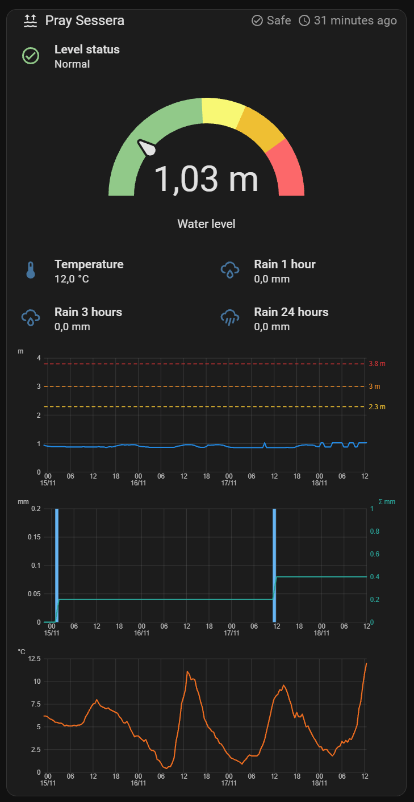
</p>

L'editor visivo sceglie la stazione e cosa mostra la scheda. In YAML,
un'opzione omessa mostra tutto:

| Opzione | Senza di essa |
| --- | --- |
| `device_id` | La prima stazione. L'ID del dispositivo della stazione, la fine dell'indirizzo della pagina del suo dispositivo. |
| `show_title: false` | Il nome della stazione, sopra il resto. Senza il nome, i badge si spostano all'inizio. |
| `show_flood_risk: false` | Il rischio di piena, nel colore del livello, accanto al nome. |
| `show_last_measurement: false` | L'ora dell'ultima misura, accanto al nome. |
| `show_level: false` | Lo stato del livello e il suo indicatore. |
| `show_readings: false` | Le misure. |
| `show_charts: false` | I grafici. |
| `columns: 1` | Le misure su due colonne. |

```yaml
# Il livello di Pray Sessera e i suoi grafici, senza le misure
type: custom:arpa-piemonte-card
device_id: 0123456789abcdef0123456789abcdef
show_readings: false
```

Un grafico da solo, con le schede di Home Assistant:

```yaml
type: picture-entity
entity: image.arpa_piemonte_pray_sessera_level_chart
show_name: false
show_state: false
```

## Fonte dei dati e attribuzione

I dati sono di **Arpa Piemonte**, sotto la licenza
[Creative Commons Attribuzione 4.0](https://creativecommons.org/licenses/by/4.0/)
([note legali](https://www.arpa.piemonte.it/note-legali)):
"Fonte: Arpa Piemonte - www.arpa.piemonte.it". Ogni entità porta questa
attribuzione, e ogni dispositivo rimanda alla pagina della sua stazione o, per
i rischi naturali, alla pagina del widget del comune, dove Arpa li mostra.

I bollettini valanghe sono quelli di AINEVA per il Piemonte, come li
pubblicano i Servizi europei di previsione valanghe (EAWS),
"Fonte: AINEVA Piemonte - bollettini.aineva.it", che le loro entità riportano;
le loro microregioni sono quelle di EAWS (CC0). Non affiliata ad AINEVA né a
EAWS.

L'integrazione legge Meteo 3R con
[aiometeo3r](https://github.com/webysther/aio-meteo3r) e le fonti ufficiali
con [aioarpapiemonte](https://github.com/webysther/aio-arpa-piemonte).

## Contribuire

Vedi [CONTRIBUTING.md](https://github.com/webysther/ha-arpa-piemonte/blob/main/CONTRIBUTING.md)
(in inglese).

## Licenza

Il codice di Arpa Piemonte è sotto la
[licenza MIT](https://github.com/webysther/ha-arpa-piemonte/blob/main/LICENSE.md).
Le misure sono dati di Arpa Piemonte, sotto la licenza
[CC BY 4.0](https://creativecommons.org/licenses/by/4.0/): ogni entità porta
questa attribuzione.

I nomi, i loghi e i marchi in questo repository, come quelli di Arpa
Piemonte, Meteo 3R e Home Assistant, appartengono ai loro proprietari e sono
usati solo per identificarli, senza implicarne l'approvazione. Non sono
coperti dalla licenza del codice né dalla licenza CC BY 4.0 dei dati.
