<p align="center">
  <picture>
    <source media="(prefers-color-scheme: dark)" srcset="https://raw.githubusercontent.com/webysther/ha-arpa-piemonte/main/custom_components/arpa_piemonte/brand/dark_icon@2x.png">
    
  </picture>
</p>

<h1 align="center">Arpa Piemonte</h1>

<p align="center">River levels, rain, temperature, wind and snow of the stations of Arpa Piemonte, and the natural risks of their municipalities, in Home Assistant</p>

<p align="center">
  <a href="https://github.com/webysther/ha-arpa-piemonte/releases/latest"></a>
  <a href="https://www.home-assistant.io/integrations/marketplace/"></a>
  <a href="https://github.com/webysther/ha-arpa-piemonte/actions/workflows/tests.yaml"></a>
  <a href="https://github.com/webysther/ha-arpa-piemonte/blob/main/LICENSE.md"></a>
</p>

The readings of the stations of [Arpa Piemonte](https://www.arpa.piemonte.it)
in Home Assistant: **river levels**, with the alert thresholds of each
hydrometer, **rain**, temperature, humidity, wind and snow, for any of the 374
stations of the Piedmont network; and the **natural risks** of their
municipalities: the alerts of the bulletin today and tomorrow, the danger now,
the operational phase, the earthquakes nearby, the heat waves and the
avalanche danger.

> Not an official app of Arpa Piemonte, and not endorsed by it. The data is
> validated automatically only. Do not rely on it for safety: for alerts,
> follow the official bulletins and the civil protection.

<p align="center">
  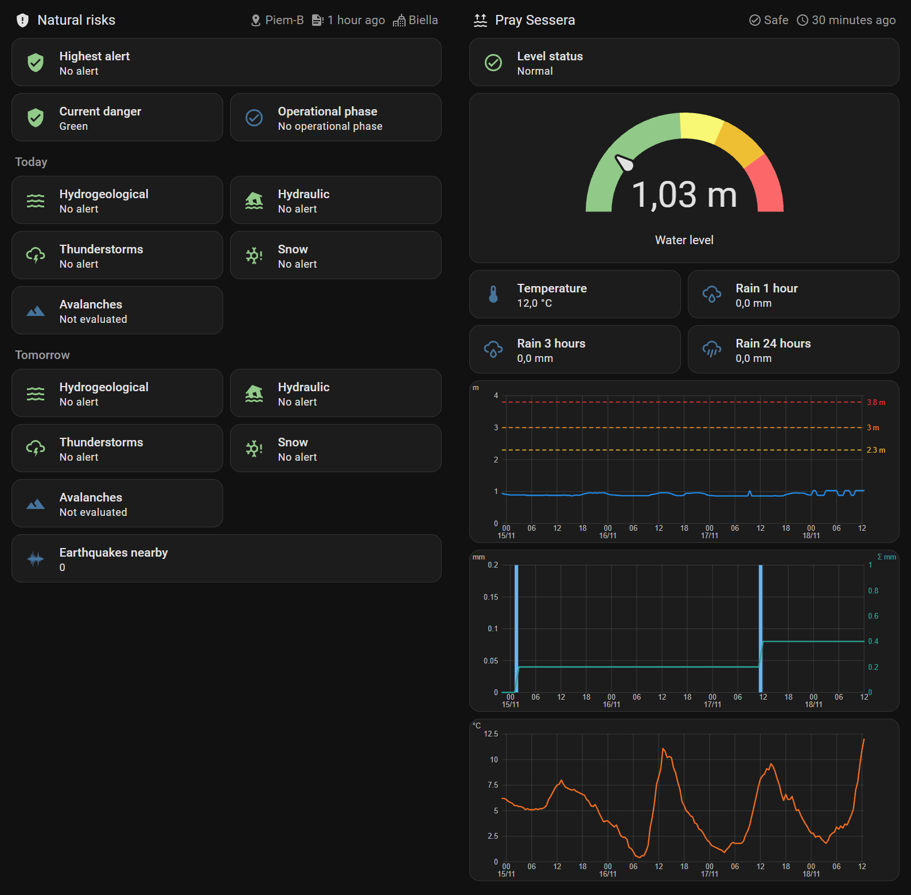
</p>

## Features

- One device per station, with the sensors it has: a hydrometer gets its water
  level, its status against the thresholds (normal, pre-alarm, guard, danger)
  and a flood risk, on from the pre-alarm threshold; a weather station its
  rain, temperature, humidity, wind and snow, and with a barometer or a
  radiometer, the atmospheric pressure and the solar radiation.
- The stations grouped by municipality: one entry per municipality, with its
  stations under it.
- The freshest readings: those of the Meteo 3R app of Arpa Piemonte, every 30
  minutes.
- When Meteo 3R does not answer, or a reading of it is too old, the official
  sources of Arpa Piemonte take over: the files of its website, then its
  api_realtime. The sensor **Data source** says which one is shown.
- The time of the measurement, not of the download: **Last measurement**.
- Charts of the last 3 to 4 days, as images: the level with its thresholds,
  the rain of each hour with its total, temperature, humidity, snow, wind,
  pressure and solar radiation. The integration draws them from the readings
  it already has.
- The natural risks of each municipality, on a device of their own, as the
  widget of the municipality on the Arpa website gives them: the level of each
  risk of the alert bulletin (hydrogeological, hydraulic, thunderstorms, snow,
  avalanches) today and tomorrow, each with a safety binary sensor on from the
  warning level you choose; the highest alert; the danger now, from the rain
  and the rivers measured; and the operational phase the municipality
  declared.
- The earthquakes of the last 30 days near the municipality, or near your
  home, on the map; the heat waves of the capital of its province, or of the
  nearest one, in summer; and the avalanche danger of its micro-region, from
  the bulletins of AINEVA, in winter.
- A [dashboard](#dashboard): a tab per municipality, with its risks at the top
  and a section per station, the level in the colors of the alert maps and a
  gauge with its thresholds; and a [card](#card) of a station, in the card
  picker.

## Use cases

- Be warned when the river near home reaches the pre-alarm threshold, before
  the official bulletins.
- Be warned in the afternoon when the bulletin puts your municipality in an
  orange alert tomorrow, or when the municipality declares an operational
  phase.
- Be warned of an earthquake within 50 km of home.
- Close the shutters early on a day of heat discomfort, or check the
  avalanche danger before going up the valley.
- Follow the rain of the last 24 hours upstream of a river.
- Close the shutters when the wind gusts, cover the plants when it freezes.

## Installation

From the [Marketplace](https://www.home-assistant.io/integrations/marketplace/)
of Home Assistant:

[](https://my.home-assistant.io/redirect/marketplace_repository/?owner=webysther&repository=ha-arpa-piemonte&category=integration)

1. Open the link above, or **Settings → Marketplace → Add from link**, and
   add `https://github.com/webysther/ha-arpa-piemonte`.
2. Open **Arpa Piemonte** and install it.

Home Assistant 2025.4 or newer.

## Configuration

**Settings → Devices & services → Add integration → Arpa Piemonte**, then
type the municipality of the station: the list has the 278 municipalities of
Piedmont with a station, and finds "Mondovì" as Arpa Piemonte writes it,
"Mondovi'". When the municipality has several stations, choose one: the
rivers first, then the weather stations. Choose the point of the river that
matters to you, not necessarily the nearest one.

<p align="center">
  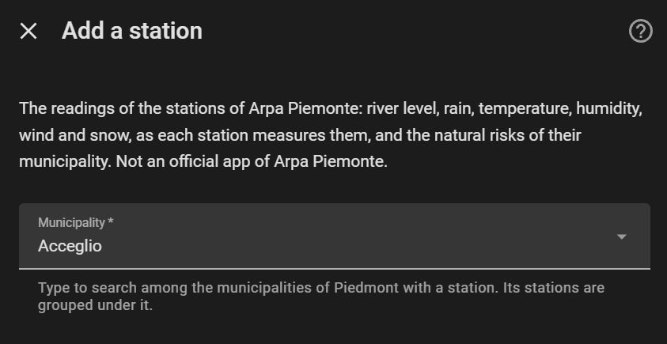
  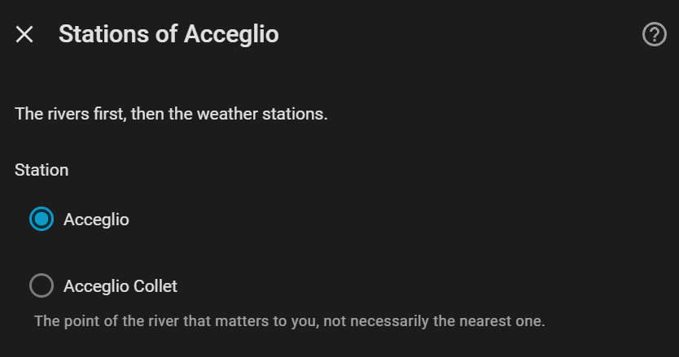
</p>

Each municipality is an entry, with its stations under it, and a device of
its natural risks beside them. To add another station of a municipality,
choose **Add station** on its entry, or add the integration again and choose
the same municipality.

<p align="center">
  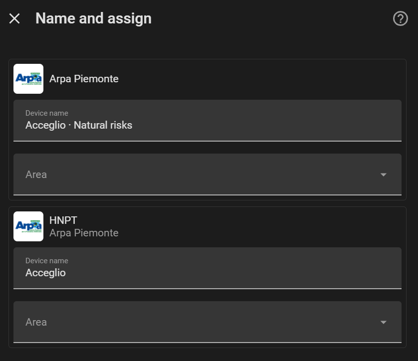
</p>

To read the sensors and thresholds of a station again from Arpa Piemonte,
choose **Read the station again** on the station. **Reconfigure** on the
entry of a municipality reads all its stations again.

### Options

**Configure** on the entry of a municipality:

| Option | What it does |
| --- | --- |
| Minimum level of warning | The binary sensor of each risk, today and tomorrow, turns on from this level of the bulletin: yellow (the default), orange or red. |
| Position of the risks | Where the earthquakes, the avalanche danger and the nearest heat-wave city are taken from: the stations of the municipality (the default; their mean position), or the home of Home Assistant. |
| Radius of the earthquakes | The earthquakes within this distance of the position, in km: 50 by default, as DPC. |
| Heat-wave city | Arpa issues the heat-wave bulletins for the 8 capitals of province only: the capital of the province of the municipality (the default), or the nearest capital to the position. |

The integration reads the position when the municipality is set up: after
moving the home of Home Assistant, reload the municipality.

## Removal

**Settings → Devices & services → Arpa Piemonte**: **Delete** in the three
dots of a station removes it; in those of a municipality, it removes the
municipality with its stations and its risks. To remove the integration,
delete every municipality, then uninstall it from the Marketplace.

## How the data is updated

Every 10 minutes, the integration asks Meteo 3R whether the file of the
station changed; most of the time it did not, and nothing is downloaded.
Meteo 3R publishes a reading every 30 minutes, about 30 to 45 minutes after it
was measured.

| Source | Readings | Late by | Asked |
| --- | --- | --- | --- |
| Meteo 3R | every 30 min | ~40 min | every 10 min |
| Files of the Arpa website (level, temperature, humidity, snow) | hourly | ~40 min | only as a fallback, every 20 min at most |
| Files of the Arpa website (pressure, solar radiation) | hourly | ~40 min | every 20 min: the only source |
| api_realtime of Arpa Piemonte (everything else) | hourly | ~3 h 40 min | only as a fallback, every 30 min at most |

Each sensor shows the newest reading of all the sources; on the same time,
Meteo 3R. A reading older than 6 hours is not shown: the sensor becomes
unavailable. **Data source** says where the readings Meteo 3R can give come
from; the pressure and the solar radiation always come from the website.

The natural risks come from the widget of the municipality on the Arpa
website, asked every 10 minutes, most of the time without a download: Arpa
rebuilds it about every 10 minutes, but its parts change less often. The
alert bulletin is issued once a day, around 13:00, for that day and the next;
the danger now is assessed every few hours from the rain and the river levels
of the last 24 hours; the operational phase changes when the municipality
declares one. Today and tomorrow are the days in Italy: at midnight, tomorrow
becomes today, and the new tomorrow is unknown until the next bulletin.

| Risk | Issued | Asked |
| --- | --- | --- |
| Alerts, danger now, operational phase (widget of the municipality) | the bulletin once a day, around 13:00; the danger every few hours | every 10 min |
| Earthquakes (Arpa) | within minutes from magnitude 2.5, after review below | every 10 min |
| Heat waves (Arpa, 8 capitals) | once a day, from 15 May to about 30 September | every 30 min |
| Avalanches (AINEVA, EAWS) | the day before, around 17:00, from December to May | every hour; out of season, every 6 hours |

Most answers are a `304 Not Modified`, without a download.

## Known limitations

- The history of Home Assistant records a reading when it is downloaded,
  30 to 45 minutes after it was measured. **Last measurement** gives the time
  of the measurement.
- Only the stations of Piedmont. Meteo 3R also shows those of Liguria and
  Valle d'Aosta, which belong to other bodies, under other terms.
- When only the api_realtime answers, the readings are about 4 hours old.
- The pressure and the solar radiation come only from the files of the
  website, hourly: while it does not answer, they become unavailable after 6
  hours, as their charts keep their last readings.
- Before Home Assistant 2026.3, the integration shows no icon: it ships its
  icon in its own folder, which older versions do not read.
- The data is validated automatically only, and Arpa Piemonte may correct it
  later. A sensor of a station can stop answering for days.
- The thresholds are those of Arpa Piemonte; not every hydrometer has all
  three (26 of 110 lack at least one).
- The charts show the readings of Meteo 3R only: while it does not answer,
  they keep its last readings. Their text is grey, darker or lighter when the
  browser says the page is light or dark, whatever the theme of Home
  Assistant.
- Before Home Assistant 2026.5, the dashboard is not listed under **Add
  dashboard**: add it with its YAML (see [Dashboard](#dashboard)).
- The dashboard reads the thresholds when it opens: the gauge of a station
  that had not answered yet appears after reloading the page.
- Every morning, the risks of tomorrow are unknown until the bulletin of the
  day, around 13:00, and the dashboard hides them.
- The risks are those the widget gives the municipality, from the alert
  zones it lies in: most are in one, a few in two (Asti, Piem-G and Piem-L).
  The avalanches are not evaluated out of season.
- The alert bulletin covers Piedmont only: Palestro, a municipality of
  Lombardy with a station of Arpa Piemonte, has no alerts, only the
  earthquakes, the heat waves of the nearest capital and the avalanches.
- The heat waves are known from 15 May to about 30 September, the avalanche
  danger from December to May: out of season, they are unknown. The avalanche
  danger exists only where the position is in one of the 14 micro-regions of
  the bulletins, the mountains: for the stations, that of their mean or else
  of a station in one.
- The earthquakes are those of the last 30 days, of magnitude 1.0 or more, in
  Piedmont and around it; an earthquake below 2.5 appears once a seismologist
  has reviewed it, an hour or more later.

## Troubleshooting

- **A sensor is unavailable**: the station has not measured it for 6 hours,
  or no source answers. Check the station on the
  [website of Arpa Piemonte](https://www.arpa.piemonte.it/rischi_naturali/snippets_arpa_graphs/dettaglio_stazione/)
  (the device links to its page).
- **Data source is not Meteo 3R**: Meteo 3R did not answer; the integration
  goes back to it as soon as it does.
- **The station cannot be added**: Arpa Piemonte did not answer; try again
  later.
- **The risks are unavailable**: their source did not answer; the
  integration asks again at its next update. The device of the risks links to
  the page of the widget on the Arpa website.
- **No earthquake, heat wave or avalanche entity**: with the position of the
  stations, a municipality whose stations were all removed has no position.
- Otherwise, download the diagnostics (the three dots of the municipality on
  the page of the integration, or the page of the device of the station) and
  open an
  [issue](https://github.com/webysther/ha-arpa-piemonte/issues) with them and a
  debug log.

## Entities

Of each station, those of its sensors:

| Entity | Unit | Of a station with |
| --- | --- | --- |
| Water level | m above the hydrometric zero | hydrometer |
| Level status: normal, pre-alarm, guard, danger | | hydrometer |
| Flood risk (safety): on from the pre-alarm threshold | | hydrometer with a threshold |
| Pre-alarm, guard and danger threshold (diagnostic) | m | hydrometer |
| Rain 1 hour, 3 hours, 24 hours | mm | rain gauge |
| Temperature | °C | thermometer |
| Humidity | % | hygrometer |
| Wind speed, gust speed | km/h | anemometer |
| Wind direction, gust direction | ° | anemometer |
| Snow depth | cm | snow gauge |
| Atmospheric pressure, at the station, not at sea level | hPa | barometer |
| Solar radiation | W/m² | radiometer |
| Data source (diagnostic): Meteo 3R, Arpa website, Arpa api_realtime | | every station |
| Last measurement (diagnostic) | | every station |
| Level, rain, temperature, humidity, snow, wind, pressure, solar radiation chart (image) | | the sensor it shows |

The entity IDs are in English: `sensor.arpa_piemonte_pray_sessera_level`,
`binary_sensor.arpa_piemonte_pray_sessera_flood_risk`,
`image.arpa_piemonte_pray_sessera_level_chart`.

<p align="center">
  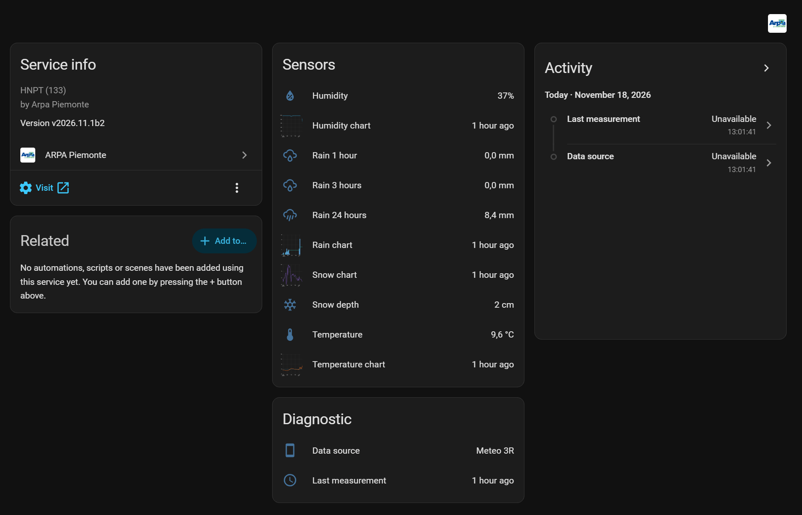
</p>

Of each municipality, its natural risks, on the device **Pray · Natural
risks**:

| Entity | States |
| --- | --- |
| Highest alert, of today and tomorrow | not evaluated, no alert (green), yellow, orange or red alert |
| Current danger, from the rain and the rivers measured | not evaluated, green, yellow, orange, red |
| Operational phase of the municipality | no operational phase, attention, pre-alarm, alarm |
| Hydrogeological, hydraulic, thunderstorm, snow and avalanche risk level, today and tomorrow | as the highest alert |
| Hydrogeological, hydraulic, thunderstorm, snow and avalanche risk, today and tomorrow (safety) | on from the minimum level of warning |
| Alert zone (diagnostic) | the zone of the bulletin: `Piem-B` |
| Alert bulletin, next alert bulletin (diagnostic) | when it was issued, when the next one is due |
| Earthquakes nearby | how many within the radius, in the last 30 days |
| Earthquake M 1.9 (geolocation), one for each | its distance, in km; its magnitude, time, depth and seismic district as attributes |
| Heat wave today, tomorrow | no discomfort, discomfort level 1, 2 or 3 (green to red) |
| Heat-wave city (diagnostic) | the capital whose bulletin it is: `Biella` |
| Avalanche danger today, tomorrow | no snow, 1 low, 2 moderate, 3 considerable, 4 high, 5 very high: the highest of the bulletin |
| Avalanche micro-region (diagnostic) | the micro-region of the position: `Valle Stura` |

Their entity IDs: `sensor.arpa_piemonte_pray_highest_alert`,
`sensor.arpa_piemonte_pray_hydraulic_risk_level_tomorrow`,
`binary_sensor.arpa_piemonte_pray_hydraulic_risk_tomorrow`,
`geo_location.arpa_piemonte_pray_earthquake_261117064149`. A risk of a day
the bulletin does not cover yet is unknown: tomorrow, in the morning. The
earthquakes, the heat waves and the avalanches exist only where the
municipality has them: a position, a capital, a micro-region.

<p align="center">
  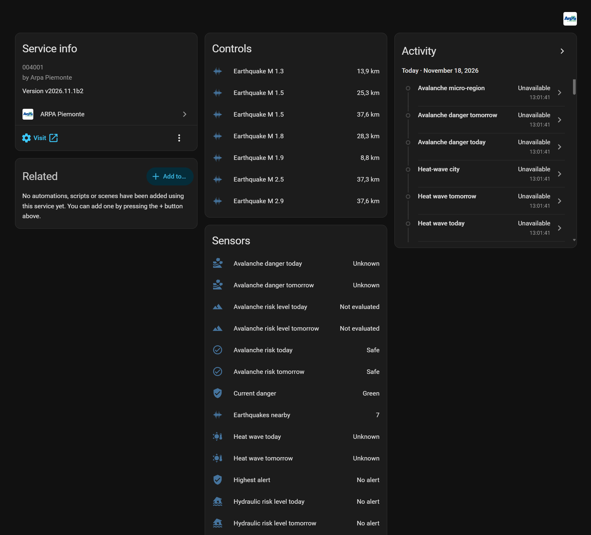
</p>

The state of a chart is the time of its newest reading. The charts carry no
words, only units and values: the dashed lines of the level are the
pre-alarm (yellow), guard (orange) and danger (red) thresholds, the bars of
the rain are the rain of each hour, and the line its total over the chart
(right axis, Σ mm); the dots of the wind are the gusts. The charts of the
pressure and the solar radiation have a reading every hour, from the files of
the website, over the same days as the others.

<p align="center">
  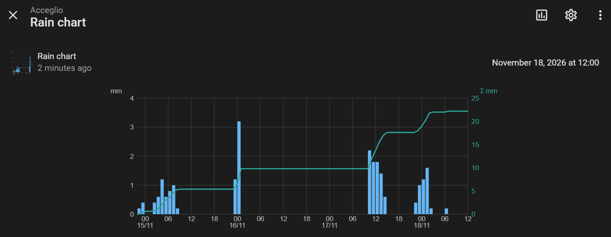
  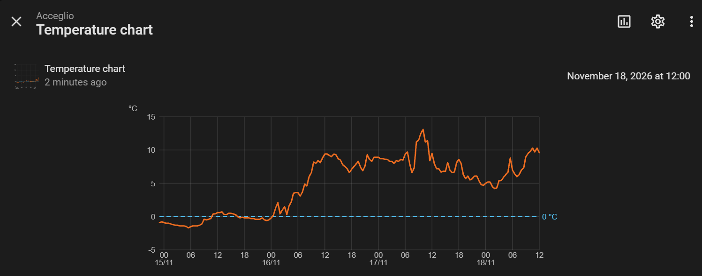
  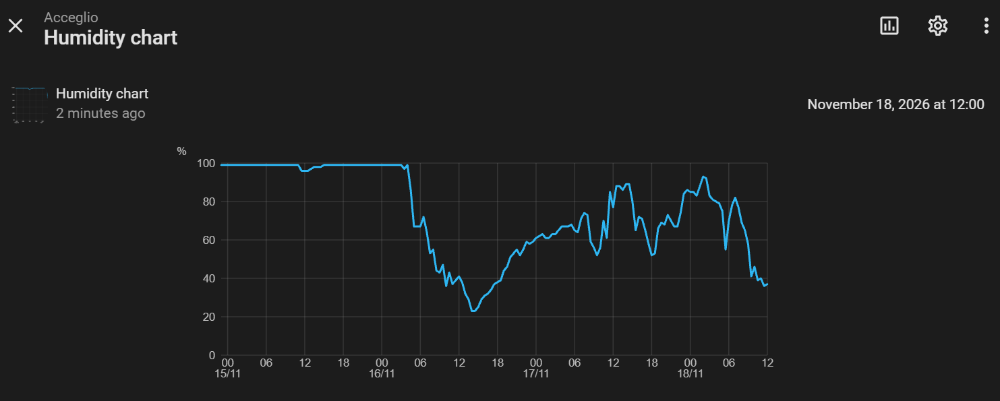
</p>

The barometers and radiometers are those the list of stations of the Arpa
website names: 45 and 64 on 2026-11-17, while the letters of the sensors in
Meteo 3R name 47 and 66, whose files are empty, years old or missing. When
that list did not answer as a station was added, the letters stand in for it:
**Read the station again** fixes it.

## Automation examples

Be warned when the river reaches a threshold:

```yaml
automation:
  - alias: "Sessera above a threshold"
    triggers:
      - trigger: state
        entity_id: binary_sensor.arpa_piemonte_pray_sessera_flood_risk
        to: "on"
    actions:
      - action: notify.notify
        data:
          title: "Sessera at Pray"
          message: >-
            Level {{ states('sensor.arpa_piemonte_pray_sessera_level') }} m:
            {{ states('sensor.arpa_piemonte_pray_sessera_level_status') }}
```

Be warned of an alert tomorrow, as soon as the bulletin is issued:

```yaml
automation:
  - alias: "Alert tomorrow in Pray"
    triggers:
      - trigger: state
        entity_id:
          - binary_sensor.arpa_piemonte_pray_hydrogeological_risk_tomorrow
          - binary_sensor.arpa_piemonte_pray_hydraulic_risk_tomorrow
          - binary_sensor.arpa_piemonte_pray_thunderstorm_risk_tomorrow
          - binary_sensor.arpa_piemonte_pray_snow_risk_tomorrow
          - binary_sensor.arpa_piemonte_pray_avalanche_risk_tomorrow
        to: "on"
    actions:
      - action: notify.notify
        data:
          title: "Pray: alert tomorrow"
          message: "{{ trigger.to_state.name }}"
```

Be warned of an earthquake within the radius, as it appears:

```yaml
automation:
  - alias: "Earthquake near Pray"
    triggers:
      - trigger: geo_location
        source: arpa_piemonte
        zone: zone.home
        event: enter
    actions:
      - action: notify.notify
        data:
          message: >-
            {{ trigger.to_state.name }},
            {{ trigger.to_state.state }} km away
```

The trigger fires for an earthquake inside the zone, whose radius is 100 m
unless you change it: give it the radius you want, or trigger on
`sensor.arpa_piemonte_pray_nearby_earthquakes` going up instead.

Be warned when the river rises fast:

```yaml
automation:
  - alias: "Sessera rising"
    triggers:
      - trigger: numeric_state
        entity_id: sensor.arpa_piemonte_pray_sessera_level
        above: 1.5
    actions:
      - action: notify.notify
        data:
          message: "The Sessera at Pray is above 1.5 m"
```

## Dashboard

The integration comes with a dashboard made of the cards of Home Assistant,
with the names of the entities in the language of each user. It has a tab for
each municipality, whose first section is its **natural risks**: the alert
zone, the time of the bulletin, the heat-wave city and the micro-region; the
highest alert and the danger now in the colors of the alert maps, the
operational phase in the colors of the widget of Arpa; the level of each risk,
the heat and the avalanche danger, today and tomorrow, each while its bulletin
covers the day; and the earthquakes nearby, on a map marked with their
magnitude.

Then a section for each station, the hydrometers first:

<p align="center">
  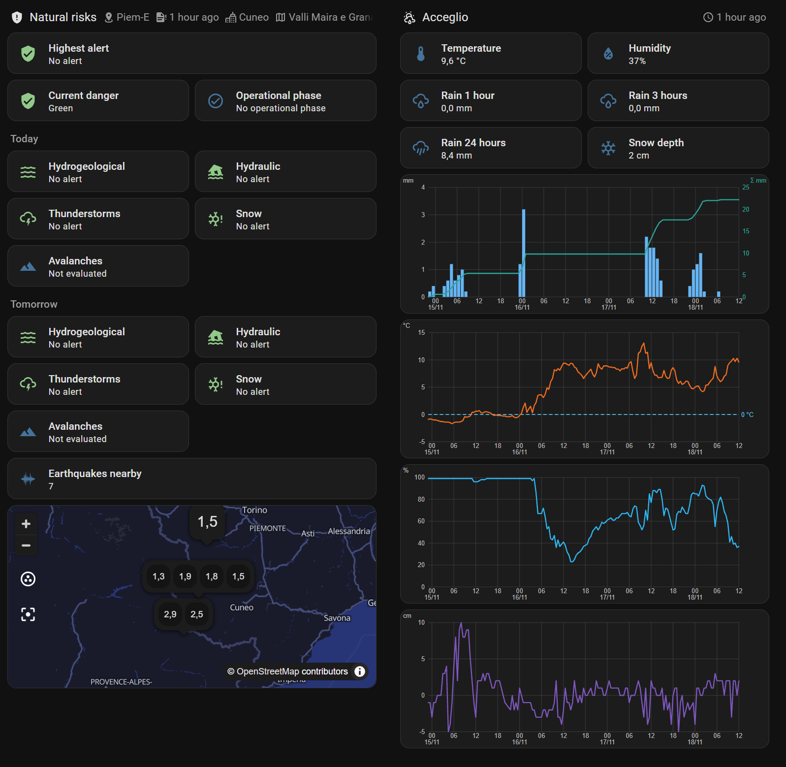
</p>

- **The heading**: the name of the station, its flood risk in the color of its
  level, the time of its last measurement and, while it is not Meteo 3R, the
  source of its readings.
- **The level** of a hydrometer: its status in the colors of the alert maps,
  green, yellow, orange and red, and a gauge with a band above each threshold,
  from 0 to the highest threshold and a quarter more (Pray Sessera, with 2.3,
  3.0 and 3.8 m, goes to 4.75 m). A hydrometer without thresholds shows its
  level.
- **The readings**: temperature, humidity, the three rains, wind, gust and snow,
  as the station measures them.
- **The charts**, once Meteo 3R has given the readings of the station.

To add it, from Home Assistant 2026.5:

1. Go to **Settings → Dashboards → Add dashboard**.
2. Choose **Arpa Piemonte**. If it is not listed, reload the page.

Before Home Assistant 2026.5:

1. Go to **Settings → Dashboards → Add dashboard → New dashboard from scratch**,
   and open it.
2. Choose **⋮ → Edit dashboard**, then **⋮ → Raw configuration editor**.
3. Replace its content with:

   ```yaml
   strategy:
     type: custom:arpa-piemonte
   ```

The dashboard follows your stations and the names you give their devices:
from Home Assistant 2026.7 it changes by itself when you add or remove one;
before, when you reload the page. To show the stations
of a municipality in another dashboard, add a view with the strategy and the
ID of the entry of the municipality (`entry_id`, in its diagnostics):

```yaml
views:
  - title: Pray
    strategy:
      type: custom:arpa-piemonte
      entry_id: 01JCQK3Z5T3K8W6B2V4M9H7XNE
```

## Card

The card of a station, in the card picker as soon as the integration is
installed: search for **Arpa Piemonte** (`custom:arpa-piemonte-card`). It is
the section of the station in the dashboard, as a single card made of the
cards of Home Assistant: it finds the entities of the station even after you
rename them, colors the level status and the flood risk as the level is, and
shows the charts that have data.

<p align="center">
  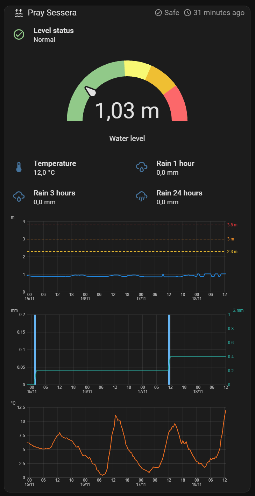
</p>

The visual editor chooses the station and what the card shows. In YAML, an
option left out shows everything:

| Option | Without it |
| --- | --- |
| `device_id` | The first station. The ID of the device of the station, the end of the address of its device page. |
| `show_title: false` | The name of the station, above the rest. Without it, the badges move to the start. |
| `show_flood_risk: false` | The flood risk, in the color of the level, beside the name. |
| `show_last_measurement: false` | The time of the last measurement, beside the name. |
| `show_level: false` | The status of the level and its gauge. |
| `show_readings: false` | The readings. |
| `show_charts: false` | The charts. |
| `columns: 1` | The readings in two columns. |

```yaml
# The level of Pray Sessera and its charts, without the readings
type: custom:arpa-piemonte-card
device_id: 0123456789abcdef0123456789abcdef
show_readings: false
```

A chart alone, with the cards of Home Assistant:

```yaml
type: picture-entity
entity: image.arpa_piemonte_pray_sessera_level_chart
show_name: false
show_state: false
```

## Data source and attribution

The data is by **Arpa Piemonte**, under the
[Creative Commons Attribution 4.0](https://creativecommons.org/licenses/by/4.0/)
license ([legal notes](https://www.arpa.piemonte.it/note-legali)): "Fonte: Arpa
Piemonte - www.arpa.piemonte.it". Every entity carries this attribution, and
each device links to the page of its station, or for the natural risks, to the
page of the widget of the municipality, where Arpa shows them.

The avalanche bulletins are those of AINEVA for Piedmont, as the European
Avalanche Warning Services (EAWS) publish them, "Fonte: AINEVA Piemonte -
bollettini.aineva.it", which their entities carry; their micro-regions are
those of EAWS (CC0). Not affiliated with AINEVA or EAWS.

The integration reads Meteo 3R with
[aiometeo3r](https://github.com/webysther/aio-meteo3r) and the official
sources with [aioarpapiemonte](https://github.com/webysther/aio-arpa-piemonte).

## Contributing

See [CONTRIBUTING.md](https://github.com/webysther/ha-arpa-piemonte/blob/main/CONTRIBUTING.md).

## License

The code of Arpa Piemonte is under the
[MIT License](https://github.com/webysther/ha-arpa-piemonte/blob/main/LICENSE.md).
The readings are data of Arpa Piemonte, under the
[CC BY 4.0](https://creativecommons.org/licenses/by/4.0/) license: every entity
carries this attribution.

The names, logos and trademarks in this repository, such as those of Arpa
Piemonte, Meteo 3R and Home Assistant, belong to their owners and are used to
identify them only, without implying their endorsement. They are not covered
by the license of the code nor by the CC BY 4.0 license of the data.
